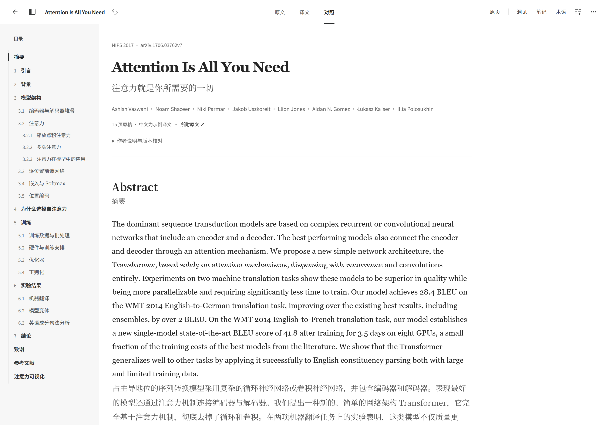
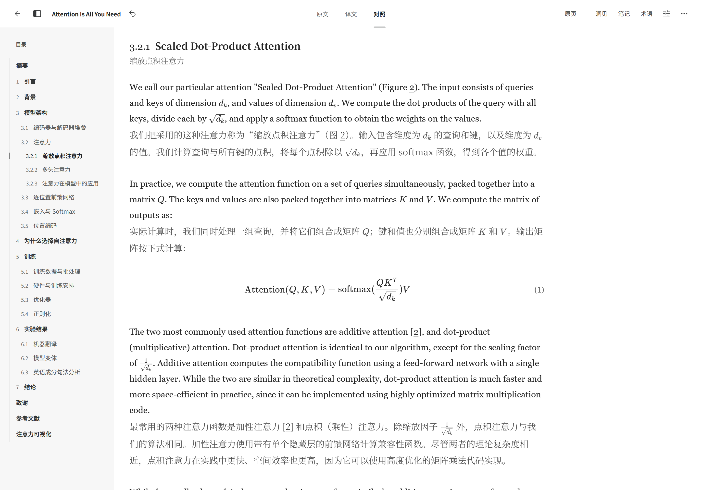
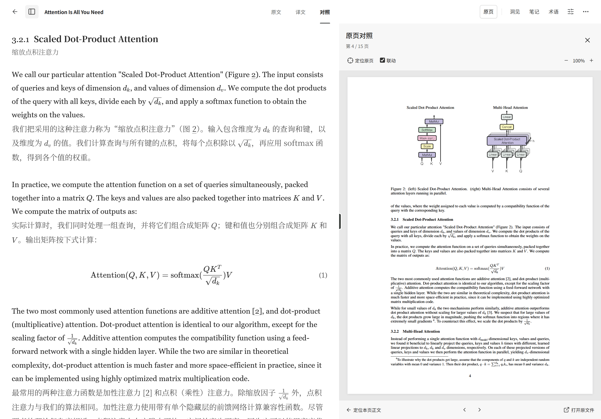

<p align="center">
  
</p>

<h1 align="center">Stread</h1>

<p align="center">
  <strong>面向论文与长文的本地阅读工作台</strong><br>
  把原文、译文、洞见和下一次阅读，放在一起。
</p>

<p align="center">
  <a href="https://github.com/Cusnd/stread/releases"><strong>下载 Stread</strong></a> ·
  <a href="docs/GETTING_STARTED.md">使用指南</a> ·
  <a href="docs/MCP.md">MCP 接入</a> ·
  <a href="docs/DEVELOPMENT.md">开发指南</a>
</p>

<p align="center">
  <a href="https://github.com/Cusnd/stread/releases"></a>
  <a href="docs/MCP.md"></a>
  <a href="LICENSE"></a>
</p>

<p align="center">
  <a href="docs/assets/attention-overview.png"></a>
</p>

## 从整理资料，到读懂与回顾

Stread 把资料管理、双语阅读和阅读积累连接起来。读到一半可以随时离开，回来时接着读；记录下来的批注、笔记和问题，也能回到它们对应的原文。

| 工作区 | 用来做什么 |
| :--- | :--- |
| **Collection · 整理** | 默认工作区。按分类、标签和阅读状态查找资料，整理阅读计划，归档或恢复文章。 |
| **Reader · 阅读** | 切换原文、译文与双语对照，查看 PDF 原页，阅读公式和图表，记录带来源位置的洞见。 |
| **Flow · 回顾** | 查看阅读活动与历史，集中管理洞见，安排下一步阅读。 |
| **Queue · 协作** | 汇集转换、纠错、译文修改和问答任务，通过稳定的任务编号交给外部 Agent。 |

从 Reader 返回时，会保留打开文章时的工作区、筛选、列表位置与草稿。资料、原文件、修订和阅读记录保存在本机。

## 对照翻译

阅读外文论文时，可以在 **原文、译文、对照** 三种视图之间切换。对照模式把每段原文与对应译文放在一起，读中文理解内容，也能随时核对原文的措辞与推导。

- **逐段对照**：原文与译文相邻呈现，公式、图表和引用保留在阅读上下文中。
- **调整顺序**：在阅读设置中选择原文在前或译文在前，并切换已有的译文语言。
- **核对来源**：打开 PDF 原页，对照原始材料查看公式、图表、脚注和版式。

非中文资料默认转换为完整原文与简体中文，也可在转换要求中指定其他语言。译文由外部 Agent 生成、审阅后保存；阅读时切换视图直接使用已有内容，不会即时调用模型翻译。

<p align="center">
  <a href="docs/assets/attention-bilingual.png"></a>
</p>

## PDF 原页对照

点击阅读工具栏的 **原页**，在正文旁打开所附 PDF。一边阅读重排正文或译文，一边核对原稿中的公式、图表、脚注与版式。

- **位置联动**：开启“联动”后，正文与 PDF 按已有来源信息关联；也可使用“定位原页”和“定位本页正文”手动跳转。
- **独立查看**：关闭联动后分别浏览正文与原稿，支持 PDF 翻页、缩放和调整原页面板宽度。

原页对照适用于附有 PDF 来源的文章，定位精度取决于转换时保留的来源信息。

<p align="center">
  <a href="docs/assets/attention-pdf-comparison.png"></a>
</p>

## 开始使用

从 [GitHub Releases](https://github.com/Cusnd/stread/releases) 下载 **Windows x64** 桌面程序，无需另外安装 Node.js 或 Python。

| 下载类型 | 适合的使用方式 |
| :--- | :--- |
| **Setup 安装版** | 按向导安装，从桌面或开始菜单打开。 |
| **Portable 单文件版** | 双击启动；资料保存在用户目录，不在可执行文件旁。 |

1. **打开一篇资料。** 在 Collection 中单击查看详情，双击进入 Reader。
2. **导入自己的文件。** 选择文件、核对转换要求，点击“加入队列”。
3. **交给 Agent 处理。** 让已连接 MCP 的外部 Agent 读取 Queue，或在任务详情中“复制给 Agent”；完成转换、独立审阅和发布后即可阅读。
4. **留下思考。** 在 Reader 记录洞见，在 Flow 安排后续阅读与回顾。

支持导入 **PDF、HTML、Markdown、文本与结构化 JSON**，单个文件最大 **64 MB**。桌面程序可在 **设置 → 更新** 中检查、下载并重启更新；具体功能与安装说明见 [Releases](https://github.com/Cusnd/stread/releases) 和[使用指南](docs/GETTING_STARTED.md)。

## 与 Agent 协作

Stread 通过 **32 个 MCP 工具**向外部 Agent 提供本机工作台能力：读取资料与任务、整理内容、回答问题，以及提交经过审阅的修订。

**加入队列 → Agent 处理 → 独立审阅 → Reader 检查 → 发布**

非中文资料默认交付**完整原文与简体中文**。转换结果需由未参与生成的审阅者对照原始材料独立复核，并在真实 Reader 中检查；确认后的最新预览才会发布。完整发布规则见[转换工作流](services/workspace/conversion-workflow.md)。

模型与 Agent 由你选择的外部客户端运行，Stread 保存任务和内容。连接方式、权限与转换要求见 [MCP 接入](docs/MCP.md)。

<details>
<summary><strong>本地数据与备份</strong></summary>

资料、原文件、预览和业务操作都在本机，桌面与 MCP 使用同一份 SQLite 数据库和文件对象，不提供云端同步。

默认资料目录为 `%USERPROFILE%\.continuous-reader`，Setup 与 Portable 共用此目录。需要独立资料库时，可通过 `--reader-user-data=<绝对目录>` 指定。备份前正常退出程序，再完整复制资料目录。详细步骤见[备份与恢复](docs/GETTING_STARTED.md#备份与恢复)。

检查与下载程序更新时会连接 GitHub。外部 Agent 是否使用远程模型，以及向模型提供哪些材料，取决于你选择的客户端和授权。

阅读统计来自实际记录的前台活动；保存阅读位置不等于完成阅读。

</details>

## 从源码运行

准备 **Git、Node.js 24+ 和 Python 3.10+**，安装依赖：

```powershell
git clone https://github.com/Cusnd/stread.git
cd stread
npm ci
npm run setup
```

完成[开发指南中的 Python 配置](docs/DEVELOPMENT.md#准备-python)后，使用独立开发资料目录启动：

```powershell
$devProfile = Join-Path $env:USERPROFILE '.stread-development'
npm run desktop:dev -- "--reader-user-data=$devProfile"
```

桌面开发支持前端热更新，桌面或服务代码变化时会保存后重启。浏览器开发、环境配置与打包方式见[开发指南](docs/DEVELOPMENT.md)。

<details>
<summary><strong>常用开发命令</strong></summary>

| 命令 | 用途 |
| :--- | :--- |
| `npm run dev` | 启动浏览器前端与本机工作台服务。 |
| `npm run desktop:dev` | 启动支持热更新的桌面开发窗口。 |
| `npm test` | 运行前端、工作台与术语模块测试。 |
| `npm run test:desktop` | 运行桌面生命周期、打包、MCP、PDF 与更新测试。 |
| `npm run build` | 构建前端产物。 |
| `npm run desktop:pack` | 生成 Windows 安装版与 Portable。 |

`npm test` 不包含桌面测试。构建、浏览器检查与安装程序验证需分别完成，详见[修改后的验证](docs/DEVELOPMENT.md#修改后的验证)。

</details>

## 文档与贡献

| 使用 Stread | 开发与维护 |
| :--- | :--- |
| [使用指南](docs/GETTING_STARTED.md) | [开发指南](docs/DEVELOPMENT.md) |
| [MCP 接入](docs/MCP.md) | [架构说明](docs/ARCHITECTURE.md) |
| [故障排查](docs/TROUBLESHOOTING.md) | [发布指南](docs/RELEASING.md) |
| [更新记录](CHANGELOG.md) | [贡献指南](CONTRIBUTING.md) |

欢迎通过 [Issues](https://github.com/Cusnd/stread/issues) 反馈问题或提出建议。安全问题请按[安全政策](SECURITY.md)报告。

## 许可

项目代码采用 [**AGPL-3.0-only**](LICENSE)。依赖、字体、图标及论文示例等第三方材料保留各自许可或权利，详见[第三方说明](THIRD_PARTY_NOTICES.md)。
