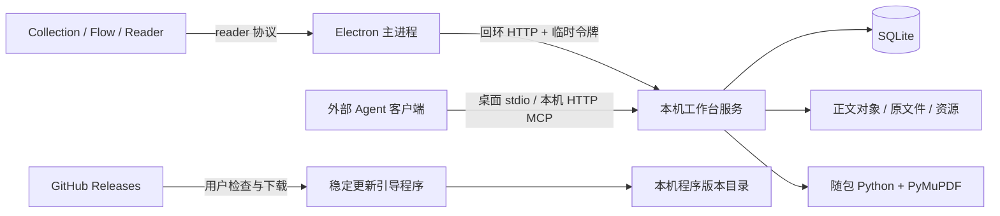

# 架构说明

[返回 README](../README.md) · [开发指南](DEVELOPMENT.md) · [MCP 接入](MCP.md)

## 运行边界

Stread 的桌面发行程序由 Electron、React Reader 和一个本机工作台服务组成。工作台负责数据与业务规则；外部 Agent 通过 MCP 使用同一套规则。资料库和执行过程以本机为边界，程序更新单独从 GitHub 下载。

桌面不包含 Agent 宿主或模型运行器。Agent 是否使用远程模型由外部客户端决定；Reader 不会通过打开文章、保存请求或导入原文件自动运行模型。

## 主要模块

| 路径 | 职责 |
| --- | --- |
| `electron/bootstrap.cjs` | 获取单实例所有权，选择可验证的程序版本，再加载主进程。 |
| `electron/main.cjs` | 窗口、协议代理、权限、会话保存、服务生命周期和更新 IPC。 |
| `electron/preload.cjs` | 在隔离的 renderer 中暴露固定、受限的桌面能力。 |
| `electron/backend.cjs` | 在 Electron utility process 中启动本机工作台。 |
| `electron/mcp.cjs` | 从桌面 profile 获取临时连接信息，并转发 MCP stdio。 |
| `prototypes/insight-composer/src` | Collection、Flow、Reader、共享设置与交互。目录名保留历史命名，内容是当前前端。 |
| `services/workspace` | SQLite 业务、对象存储、HTTP/MCP、authoring、预览、审阅与发布。 |
| `electron/update-core.cjs` | GitHub 更新发现、签名校验、下载、版本组装与启动恢复。 |
| `electron/build-update.mjs` | 创建完整程序层包、文件差分、签名清单和兼容性基线。 |
| `spec` | 产品约束、文档格式和转换协议。 |

## 桌面与浏览器

桌面 Reader 使用 `reader://app`。主进程把应用请求代理到只监听本机回环地址的服务；鉴权令牌保留在主进程，浏览器页面不直接持有桌面令牌。renderer 使用 context isolation 和 sandbox，桌面操作通过固定 IPC 能力完成。

桌面开发模式把前端请求交给本机 Vite，把业务请求交给同一资料服务。普通浏览器开发使用 HTTP 来源；其 localStorage、sessionStorage 和桌面 profile 彼此独立。

桌面只允许同一 profile 的一个 UI 实例。MCP 连接可以启动独立的转发进程，但不会再启动一份业务后端。主程序退出或重启后，客户端需要重连。

## 存储与身份

SQLite 保存资料元数据、阅读状态、洞见、计划、术语、索引、版本和幂等回执。正文、作者输入、冻结预览及大型报告存为内容寻址的不可变对象；原文件与资源保存在本机文件目录。

对象先成功写入，再提交数据库引用。写操作保留稳定身份、版本检查和准确的请求回执。响应丢失后重试同一命令时，应复用原 request ID 和原参数；内容发生变化则是新的命令。

桌面默认 profile 为 `%USERPROFILE%\.continuous-reader`，实际资料在其 `workspace` 子目录。产品更名为 Stread 后，应用标识 `com.continuousreader.desktop` 和存储位置继续沿用；环境变量、CLI 参数、IPC/浏览器存储键及 `continous-reader` 文档格式和扩展标识也保持兼容。独立 profile 与安装目录分离；增量程序文件保存在 profile 的 `updates`，不会代替业务资料。

历史同步身份、冲突和回执可以继续作为本地证据保存；它们不会启动云同步。备份单位是完整 profile，不能只取一个 SQLite 文件。

## 内容、转换与审阅

Reader 渲染有稳定块身份的结构化正文，并保留原文、翻译、公式、资源、来源位置及文章修订。语言切换选择已经保存的内容，不执行在线翻译。

外部 Agent 根据 authoring 合同提交作者输入和资源，服务创建带准确哈希的不可变预览。结构或资源校验通过只说明该层检查通过；原文保真、实际显示和可读性需要独立审阅。

发布前，生成方必须实际启动未参与创作的独立审阅者。审阅者先核对原件，再检查指定候选和真实 Reader；修复后重新审阅最新哈希。服务校验绑定、翻译完整性和阻断问题，并保存证据；它不能凭一份自述证明所有语义判断都真实正确。

完整流程与字段定义见[转换工作流](../services/workspace/conversion-workflow.md)和[authoring 指南](../services/workspace/authoring-guide.md)。

## 增量更新

完整安装包提供稳定引导程序、更新公钥、Electron、生产依赖与 Python。程序层更新携带桌面业务文件、前端、服务及所需合同资源。

发布清单包含版本、文件路径／大小／SHA-256、基础兼容性摘要、完整程序层包和可选差分包。清单由 Ed25519 签名，客户端在使用清单前校验签名，再校验实际下载与所有目标文件。

客户端只在已有清单摘要与差分基线匹配时使用差分，否则使用完整程序层包。底层依赖从当前安装在本机复制并校验，不随日常差分重新下载。组装完成的目录保持独立，直到用户完成保存并重启后才切换。

新版本先作为试运行版本启动。后端就绪与 Reader 界面完成启动后才确认健康；失败或上次试运行未完成时恢复先前程序。MCP 启动不会改变 UI 的试运行状态。

基础摘要涵盖稳定引导程序、公钥、平台、Electron、生产依赖、Python 以及数据库结构相关文件。变化时需要完整安装包。日常程序回退仅回退代码，不回退资料；任何不兼容数据变更都应按完整发布流程处理。

## 修改时保持的约束

- Collection 是默认入口；Reader 返回到打开它的工作区。
- 阅读完成状态与保存位置分开，统计只使用实际记录的活动。
- 语言、来源和洞见身份稳定，编辑操作受版本检查保护。
- MCP 保持当前 32 工具合同；读取有界，写入需要明确授权。
- 原文件、已发布修订和审阅证据不能被构建、更新或清理误删。
- 程序更新的下载签名与 Windows 可执行文件代码签名是两个不同机制。
