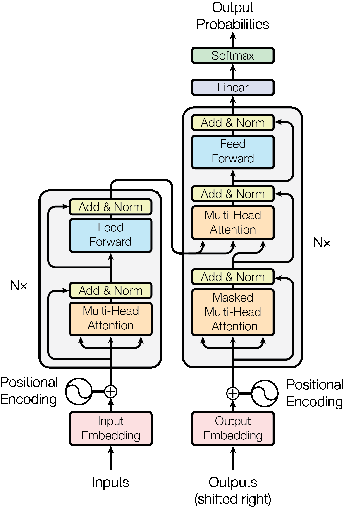
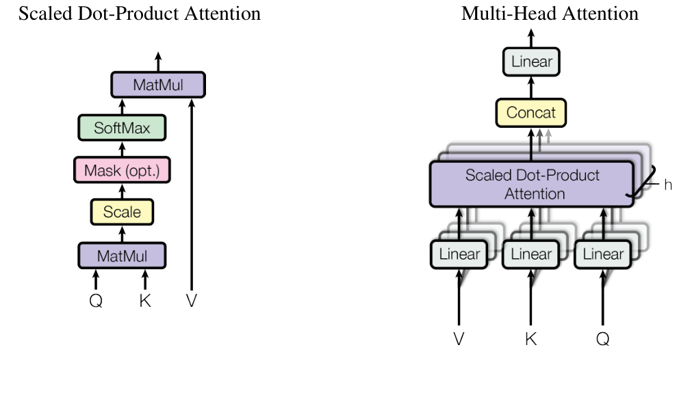
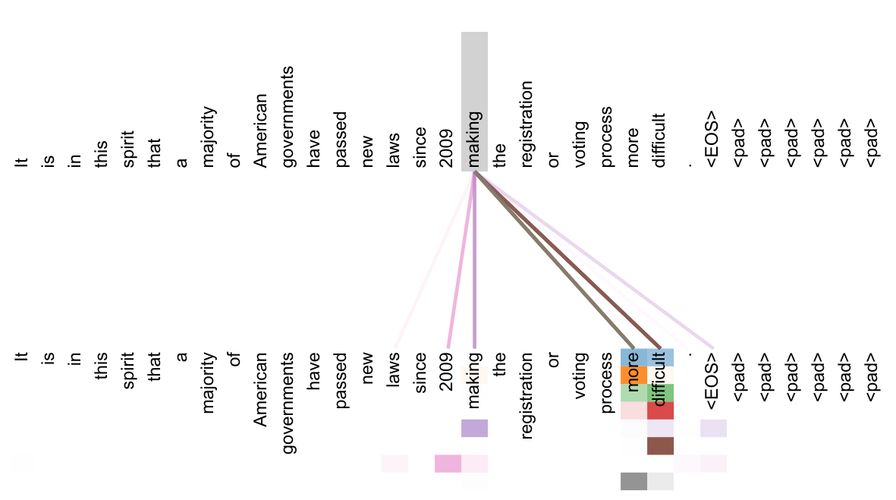
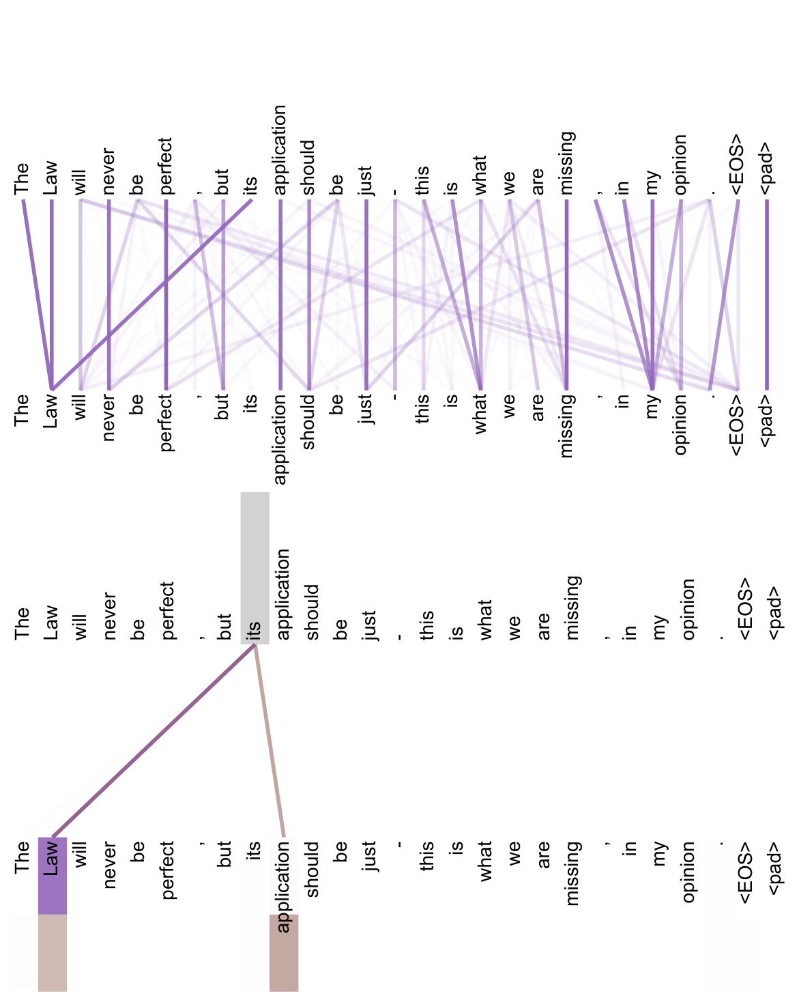
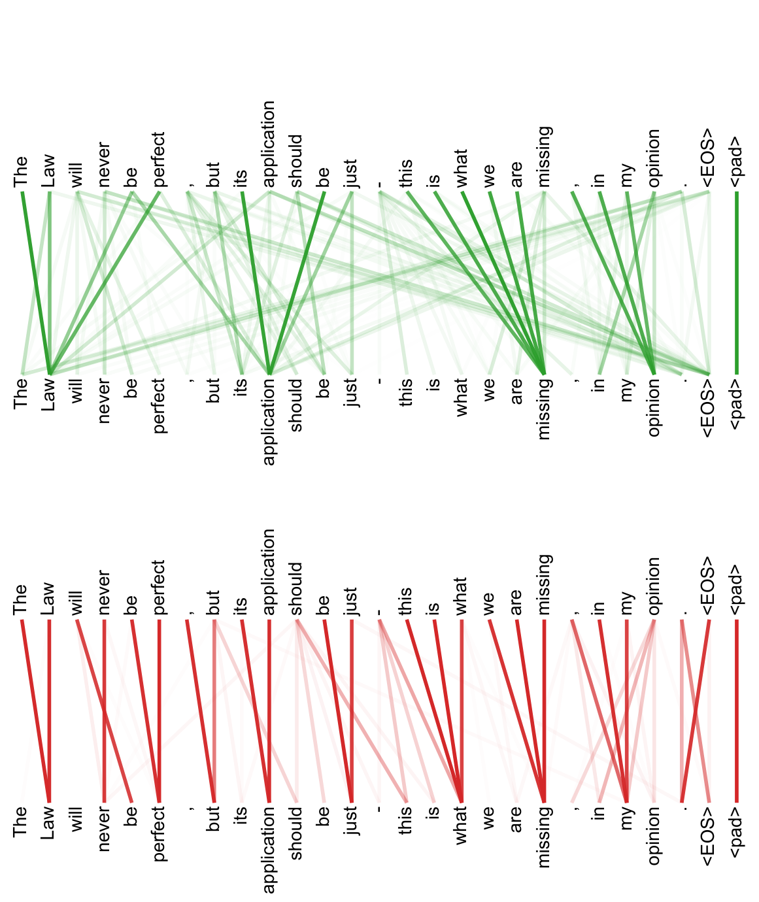

# Attention Is All You Need

注意力就是你所需要的一切

Ashish Vaswani · Noam Shazeer · Niki Parmar · Jakob Uszkoreit · Llion Jones · Aidan N. Gomez · Łukasz Kaiser · Illia Polosukhin

2017; arXiv v7: 2023-08-02

来源：[用户提供的 PDF](source.pdf) · [arXiv v7](https://arxiv.org/abs/1706.03762v7)。中文为本示例译文，非作者审定译本。

Provided proper attribution is provided, Google hereby grants permission to reproduce the tables and figures in this paper solely for use in journalistic or scholarly works.

在恰当注明出处的前提下，Google 特此允许仅在新闻报道或学术作品中转载本文的表格和图片。

Ashish Vaswani∗ — Google Brain — avaswani@google.com; Noam Shazeer∗ — Google Brain — noam@google.com; Niki Parmar∗ — Google Research — nikip@google.com; Jakob Uszkoreit∗ — Google Research — usz@google.com; Llion Jones∗ — Google Research — llion@google.com; Aidan N. Gomez∗† — University of Toronto — aidan@cs.toronto.edu; Łukasz Kaiser∗ — Google Brain — lukaszkaiser@google.com; Illia Polosukhin∗‡ — illia.polosukhin@gmail.com.

Ashish Vaswani∗ — Google Brain — avaswani@google.com；Noam Shazeer∗ — Google Brain — noam@google.com；Niki Parmar∗ — Google Research — nikip@google.com；Jakob Uszkoreit∗ — Google Research — usz@google.com；Llion Jones∗ — Google Research — llion@google.com；Aidan N. Gomez∗† — 多伦多大学 — aidan@cs.toronto.edu；Łukasz Kaiser∗ — Google Brain — lukaszkaiser@google.com；Illia Polosukhin∗‡ — illia.polosukhin@gmail.com。

## Abstract / 摘要

The dominant sequence transduction models are based on complex recurrent or convolutional neural networks that include an encoder and a decoder. The best performing models also connect the encoder and decoder through an attention mechanism. We propose a new simple network architecture, the Transformer, based solely on attention mechanisms, dispensing with recurrence and convolutions entirely. Experiments on two machine translation tasks show these models to be superior in quality while being more parallelizable and requiring significantly less time to train. Our model achieves 28.4 BLEU on the WMT 2014 English-to-German translation task, improving over the existing best results, including ensembles, by over 2 BLEU. On the WMT 2014 English-to-French translation task, our model establishes a new single-model state-of-the-art BLEU score of 41.8 after training for 3.5 days on eight GPUs, a small fraction of the training costs of the best models from the literature. We show that the Transformer generalizes well to other tasks by applying it successfully to English constituency parsing both with large and limited training data.

占主导地位的序列转换模型采用复杂的循环神经网络或卷积神经网络，并包含编码器和解码器。表现最好的模型还通过注意力机制连接编码器与解码器。我们提出一种新的、简单的网络架构 Transformer，它完全基于注意力机制，彻底去掉了循环和卷积。在两项机器翻译任务上的实验表明，这类模型不仅质量更高，而且更易于并行化，所需训练时间也显著减少。我们的模型在 WMT 2014 英德翻译任务上取得 28.4 BLEU，比此前包括集成模型在内的最佳结果提高了超过 2 BLEU。在 WMT 2014 英法翻译任务上，模型仅在 8 块 GPU 上训练 3.5 天，就以 41.8 BLEU 创下新的单模型最佳水平，而训练成本只是文献中最佳模型的一小部分。我们还将 Transformer 成功应用于英语成分句法分析，在训练数据充足和有限的两种条件下都取得了效果，说明它能够很好地泛化到其他任务。

* Equal contribution. Listing order is random. Jakob proposed replacing RNNs with self-attention and started the effort to evaluate this idea. Ashish, with Illia, designed and implemented the first Transformer models and has been crucially involved in every aspect of this work. Noam proposed scaled dot-product attention, multi-head attention and the parameter-free position representation and became the other person involved in nearly every detail. Niki designed, implemented, tuned and evaluated countless model variants in our original codebase and tensor2tensor. Llion also experimented with novel model variants, was responsible for our initial codebase, and efficient inference and visualizations. Lukasz and Aidan spent countless long days designing various parts of and implementing tensor2tensor, replacing our earlier codebase, greatly improving results and massively accelerating our research.

* 各位作者贡献相同，署名顺序随机。Jakob 提出了用自注意力替代 RNN 的想法，并发起了对这一想法的评估。Ashish 与 Illia 一起设计、实现了最初的 Transformer 模型，并深度参与了这项工作的各个方面。Noam 提出了缩放点积注意力、多头注意力和无参数的位置表示，也成为几乎参与所有细节的另一位成员。Niki 在最初的代码库和 tensor2tensor 中设计、实现、调优并评估了大量模型变体。Llion 也实验了新的模型变体，负责最初的代码库、高效推理和可视化。Lukasz 与 Aidan 花费了大量时间设计和实现 tensor2tensor 的不同部分，以它替换早期代码库，大幅改善了结果，并极大加快了研究进程。

† Work performed while at Google Brain.

† 本项工作在 Google Brain 任职期间完成。

‡ Work performed while at Google Research.

‡ 本项工作在 Google Research 任职期间完成。

31st Conference on Neural Information Processing Systems (NIPS 2017), Long Beach, CA, USA.

第 31 届神经信息处理系统大会（NIPS 2017），美国加利福尼亚州长滩。

## 1 Introduction / 引言

Recurrent neural networks, long short-term memory [[13](#bib.bib13)] and gated recurrent [[7](#bib.bib7)] neural networks in particular, have been firmly established as state of the art approaches in sequence modeling and transduction problems such as language modeling and machine translation [[35](#bib.bib35), [2](#bib.bib2), [5](#bib.bib5)]. Numerous efforts have since continued to push the boundaries of recurrent language models and encoder-decoder architectures [[38](#bib.bib38), [24](#bib.bib24), [15](#bib.bib15)].

循环神经网络，尤其是长短期记忆网络 [[13](#bib.bib13)] 和门控循环神经网络 [[7](#bib.bib7)]，已经确立了在序列建模与序列转换问题中的先进地位，典型任务包括语言建模和机器翻译 [[35](#bib.bib35), [2](#bib.bib2), [5](#bib.bib5)]。此后，大量研究不断推进循环语言模型以及编码器—解码器架构的能力边界 [[38](#bib.bib38), [24](#bib.bib24), [15](#bib.bib15)]。

Recurrent models typically factor computation along the symbol positions of the input and output sequences. Aligning the positions to steps in computation time, they generate a sequence of hidden states $h_{t}$, as a function of the previous hidden state $h_{t-1}$ and the input for position $t$. This inherently sequential nature precludes parallelization within training examples, which becomes critical at longer sequence lengths, as memory constraints limit batching across examples. Recent work has achieved significant improvements in computational efficiency through factorization tricks [[21](#bib.bib21)] and conditional computation [[32](#bib.bib32)], while also improving model performance in case of the latter. The fundamental constraint of sequential computation, however, remains.

循环模型通常沿输入、输出序列的符号位置拆分计算。它们将位置与计算时间步对应起来，根据前一隐藏状态 $h_{t-1}$ 和位置 $t$ 的输入生成隐藏状态 $h_t$。这种内在的顺序性质使单个训练样本内部无法并行计算；当序列较长时，这一问题尤其突出，因为内存限制也会约束跨样本的批处理。近期研究通过因子分解技巧 [[21](#bib.bib21)] 和条件计算 [[32](#bib.bib32)] 显著提高了计算效率，其中后者还改善了模型性能。然而，顺序计算这一根本限制仍然存在。

Attention mechanisms have become an integral part of compelling sequence modeling and transduction models in various tasks, allowing modeling of dependencies without regard to their distance in the input or output sequences [[2](#bib.bib2), [19](#bib.bib19)]. In all but a few cases [[27](#bib.bib27)], however, such attention mechanisms are used in conjunction with a recurrent network.

注意力机制已成为多种任务中优秀序列建模与序列转换模型的重要组成部分，使模型能够捕捉输入或输出序列中的依赖关系，而不受位置间距离的限制 [[2](#bib.bib2), [19](#bib.bib19)]。但除少数情况 [[27](#bib.bib27)] 外，这些注意力机制都与循环网络结合使用。

In this work we propose the Transformer, a model architecture eschewing recurrence and instead relying entirely on an attention mechanism to draw global dependencies between input and output. The Transformer allows for significantly more parallelization and can reach a new state of the art in translation quality after being trained for as little as twelve hours on eight P100 GPUs.

本文提出 Transformer：这一模型架构摒弃循环，完全依靠注意力机制来建立输入与输出之间的全局依赖关系。Transformer 支持显著更多的并行计算，仅在 8 块 P100 GPU 上训练短至 12 小时，就能够达到新的机器翻译质量最佳水平。

## 2 Background / 背景

The goal of reducing sequential computation also forms the foundation of the Extended Neural GPU [[16](#bib.bib16)], ByteNet [[18](#bib.bib18)] and ConvS2S [[9](#bib.bib9)], all of which use convolutional neural networks as basic building block, computing hidden representations in parallel for all input and output positions. In these models, the number of operations required to relate signals from two arbitrary input or output positions grows in the distance between positions, linearly for ConvS2S and logarithmically for ByteNet. This makes it more difficult to learn dependencies between distant positions [[12](#bib.bib12)]. In the Transformer this is reduced to a constant number of operations, albeit at the cost of reduced effective resolution due to averaging attention-weighted positions, an effect we counteract with Multi-Head Attention as described in section [3.2](#S3.SS2).

减少顺序计算也是 Extended Neural GPU [[16](#bib.bib16)]、ByteNet [[18](#bib.bib18)] 和 ConvS2S [[9](#bib.bib9)] 的基本目标。这些模型都以卷积神经网络为基本构件，并行计算所有输入、输出位置的隐藏表示。在这些模型中，关联任意两个输入或输出位置的信号所需的操作次数，会随位置间距离增长：ConvS2S 为线性增长，ByteNet 为对数增长。这使得远距离依赖更难学习 [[12](#bib.bib12)]。在 Transformer 中，该操作次数降为常数；但代价是对各位置进行注意力加权平均会降低有效分辨率。我们通过第 [3.2](#S3.SS2) 节所述的多头注意力抵消这一影响。

Self-attention, sometimes called intra-attention is an attention mechanism relating different positions of a single sequence in order to compute a representation of the sequence. Self-attention has been used successfully in a variety of tasks including reading comprehension, abstractive summarization, textual entailment and learning task-independent sentence representations [[4](#bib.bib4), [27](#bib.bib27), [28](#bib.bib28), [22](#bib.bib22)].

自注意力有时也称为内部注意力，它关联同一序列中的不同位置，以计算该序列的表示。自注意力已成功用于阅读理解、抽象式摘要、文本蕴含以及学习与任务无关的句子表示等任务 [[4](#bib.bib4), [27](#bib.bib27), [28](#bib.bib28), [22](#bib.bib22)]。

End-to-end memory networks are based on a recurrent attention mechanism instead of sequence-aligned recurrence and have been shown to perform well on simple-language question answering and language modeling tasks [[34](#bib.bib34)].

端到端记忆网络基于循环式注意力机制，而非与序列位置对齐的循环计算；已有研究表明，它们在简单语言问答和语言建模任务上表现良好 [[34](#bib.bib34)]。

To the best of our knowledge, however, the Transformer is the first transduction model relying entirely on self-attention to compute representations of its input and output without using sequence-aligned RNNs or convolution. In the following sections, we will describe the Transformer, motivate self-attention and discuss its advantages over models such as [[17](#bib.bib17), [18](#bib.bib18)] and [[9](#bib.bib9)].

不过，据我们所知，Transformer 是首个完全依赖自注意力计算输入、输出表示的序列转换模型，不使用与序列位置对齐的 RNN 或卷积。下文将描述 Transformer，说明采用自注意力的动机，并讨论它相较于 [[17](#bib.bib17), [18](#bib.bib18)] 和 [[9](#bib.bib9)] 等模型的优势。

## 3 Model Architecture / 模型架构

Figure 1: The Transformer - model architecture.

图 1：Transformer 模型架构。

Text in figure: Inputs; Input Embedding; Positional Encoding; Multi-Head Attention; Add & Norm; Feed Forward; N×; Outputs (shifted right); Output Embedding; Masked Multi-Head Attention; Linear; Softmax; Output Probabilities.

图中文字：输入；输入嵌入；位置编码；多头注意力；相加与归一化；前馈网络；重复 N 次；输出（右移）；输出嵌入；带掩码的多头注意力；线性变换；Softmax；输出概率。

Most competitive neural sequence transduction models have an encoder-decoder structure [[5](#bib.bib5), [2](#bib.bib2), [35](#bib.bib35)]. Here, the encoder maps an input sequence of symbol representations $(x_{1},...,x_{n})$ to a sequence of continuous representations $\mathbf{z}=(z_{1},...,z_{n})$. Given $\mathbf{z}$, the decoder then generates an output sequence $(y_{1},...,y_{m})$ of symbols one element at a time. At each step the model is auto-regressive [[10](#bib.bib10)], consuming the previously generated symbols as additional input when generating the next.

大多数具有竞争力的神经序列转换模型都采用编码器—解码器结构 [[5](#bib.bib5), [2](#bib.bib2), [35](#bib.bib35)]。编码器将输入符号表示序列 $(x_1,\ldots,x_n)$ 映射为连续表示序列 $\mathbf{z}=(z_1,\ldots,z_n)$。给定 $\mathbf{z}$ 后，解码器逐个生成输出符号序列 $(y_1,\ldots,y_m)$。模型在每一步都是自回归的 [[10](#bib.bib10)]：生成下一个符号时，会把此前已生成的符号作为额外输入。

The Transformer follows this overall architecture using stacked self-attention and point-wise, fully connected layers for both the encoder and decoder, shown in the left and right halves of Figure [1](#S3.F1), respectively.

Transformer 沿用这一总体架构，在编码器和解码器中都使用堆叠的自注意力层与逐位置全连接层，分别如图 [1](#S3.F1) 的左半部分和右半部分所示。

### 3.1 Encoder and Decoder Stacks / 编码器与解码器堆叠

##### Encoder: / 编码器：

The encoder is composed of a stack of $N=6$ identical layers. Each layer has two sub-layers. The first is a multi-head self-attention mechanism, and the second is a simple, position-wise fully connected feed-forward network. We employ a residual connection [[11](#bib.bib11)] around each of the two sub-layers, followed by layer normalization [[1](#bib.bib1)]. That is, the output of each sub-layer is $\mathrm{LayerNorm}(x+\mathrm{Sublayer}(x))$, where $\mathrm{Sublayer}(x)$ is the function implemented by the sub-layer itself. To facilitate these residual connections, all sub-layers in the model, as well as the embedding layers, produce outputs of dimension $d_{\text{model}}=512$.

编码器由 $N=6$ 个结构相同的层堆叠而成。每层包含两个子层：第一个是多头自注意力机制，第二个是简单的、逐位置的全连接前馈网络。我们在每个子层外使用残差连接 [[11](#bib.bib11)]，然后进行层归一化 [[1](#bib.bib1)]。也就是说，每个子层的输出为 $\mathrm{LayerNorm}(x+\mathrm{Sublayer}(x))$，其中 $\mathrm{Sublayer}(x)$ 是该子层实现的函数。为便于使用残差连接，模型中的所有子层以及嵌入层都输出维度为 $d_{\text{model}}=512$ 的表示。

##### Decoder: / 解码器：

The decoder is also composed of a stack of $N=6$ identical layers. In addition to the two sub-layers in each encoder layer, the decoder inserts a third sub-layer, which performs multi-head attention over the output of the encoder stack. Similar to the encoder, we employ residual connections around each of the sub-layers, followed by layer normalization. We also modify the self-attention sub-layer in the decoder stack to prevent positions from attending to subsequent positions. This masking, combined with fact that the output embeddings are offset by one position, ensures that the predictions for position $i$ can depend only on the known outputs at positions less than $i$.

解码器同样由 $N=6$ 个结构相同的层堆叠而成。除编码器每层中的两个子层外，解码器还插入第三个子层，对编码器堆叠的输出执行多头注意力。与编码器类似，我们在每个子层外使用残差连接，然后进行层归一化。我们还修改了解码器堆叠中的自注意力子层，防止当前位置关注后续位置。这种掩码操作与输出嵌入向右错开一个位置的做法相结合，确保位置 $i$ 的预测只能依赖小于 $i$ 的位置上已经知道的输出。

### 3.2 Attention / 注意力

An attention function can be described as mapping a query and a set of key-value pairs to an output, where the query, keys, values, and output are all vectors. The output is computed as a weighted sum of the values, where the weight assigned to each value is computed by a compatibility function of the query with the corresponding key.

注意力函数可以描述为：将一个查询以及一组键值对映射为一个输出，其中查询、键、值和输出都是向量。输出是各个值的加权和；每个值的权重由查询与对应键之间的兼容性函数计算得到。

#### 3.2.1 Scaled Dot-Product Attention / 缩放点积注意力

We call our particular attention "Scaled Dot-Product Attention" (Figure [2](#S3.F2)). The input consists of queries and keys of dimension $d_{k}$, and values of dimension $d_{v}$. We compute the dot products of the query with all keys, divide each by $\sqrt{d_{k}}$, and apply a softmax function to obtain the weights on the values.

我们把采用的这种注意力称为“缩放点积注意力”（图 [2](#S3.F2)）。输入包含维度为 $d_k$ 的查询和键，以及维度为 $d_v$ 的值。我们计算查询与所有键的点积，将每个点积除以 $\sqrt{d_k}$，再应用 softmax 函数，得到各个值的权重。

In practice, we compute the attention function on a set of queries simultaneously, packed together into a matrix $Q$. The keys and values are also packed together into matrices $K$ and $V$. We compute the matrix of outputs as:

实际计算时，我们同时处理一组查询，并将它们组合成矩阵 $Q$；键和值也分别组合成矩阵 $K$ 和 $V$。输出矩阵按下式计算：

$$
\mathrm{Attention}(Q,K,V)=\mathrm{softmax}(\frac{QK^{T}}{\sqrt{d_{k}}})V\tag{1}
$$

The two most commonly used attention functions are additive attention [[2](#bib.bib2)], and dot-product (multiplicative) attention. Dot-product attention is identical to our algorithm, except for the scaling factor of $\frac{1}{\sqrt{d_{k}}}$. Additive attention computes the compatibility function using a feed-forward network with a single hidden layer. While the two are similar in theoretical complexity, dot-product attention is much faster and more space-efficient in practice, since it can be implemented using highly optimized matrix multiplication code.

最常用的两种注意力函数是加性注意力 [[2](#bib.bib2)] 和点积（乘性）注意力。除缩放因子 $\frac{1}{\sqrt{d_k}}$ 外，点积注意力与我们的算法相同。加性注意力使用带有单个隐藏层的前馈网络计算兼容性函数。尽管两者的理论复杂度相近，点积注意力在实践中更快、空间效率也更高，因为它可以使用高度优化的矩阵乘法代码实现。

While for small values of $d_{k}$ the two mechanisms perform similarly, additive attention outperforms dot product attention without scaling for larger values of $d_{k}$ [[3](#bib.bib3)]. We suspect that for large values of $d_{k}$, the dot products grow large in magnitude, pushing the softmax function into regions where it has extremely small gradients [4](#footnote-4). To counteract this effect, we scale the dot products by $\frac{1}{\sqrt{d_{k}}}$.

当 $d_k$ 较小时，两种机制的表现相近；但在 $d_k$ 较大时，加性注意力优于未经缩放的点积注意力 [[3](#bib.bib3)]。我们推测，当 $d_k$ 很大时，点积的数值幅度会增大，使 softmax 函数进入梯度极小的区域 [4](#footnote-4)。为抵消这一影响，我们将点积乘以 $\frac{1}{\sqrt{d_k}}$。

To illustrate why the dot products get large, assume that the components of $q$ and $k$ are independent random variables with mean $0$ and variance $1$. Then their dot product, $q\cdot k=\sum_{i=1}^{d_{k}}q_{i}k_{i}$, has mean $0$ and variance $d_{k}$.

为说明点积为什么会变大，假设 $q$ 和 $k$ 的各个分量是均值为 $0$、方差为 $1$ 的独立随机变量。那么，它们的点积 $q\cdot k=\sum_{i=1}^{d_k}q_i k_i$ 的均值为 $0$，方差为 $d_k$。

#### 3.2.2 Multi-Head Attention / 多头注意力

Figure 2: (left) Scaled Dot-Product Attention. (right) Multi-Head Attention consists of several attention layers running in parallel.

图 2：左：缩放点积注意力。右：多头注意力由多个并行运行的注意力层组成。

Text in figure: Scaled Dot-Product Attention: MatMul; Scale; Mask (opt.); SoftMax; MatMul. Multi-Head Attention: Linear; Scaled Dot-Product Attention; Concat; Linear. Q; K; V; h.

图中文字：缩放点积注意力：矩阵乘法、缩放、掩码（可选）、SoftMax、矩阵乘法；多头注意力：线性变换、缩放点积注意力、拼接、线性变换。Q、K、V 分别表示查询、键和值；h 表示注意力头数量。

Instead of performing a single attention function with $d_{\text{model}}$-dimensional keys, values and queries, we found it beneficial to linearly project the queries, keys and values $h$ times with different, learned linear projections to $d_{k}$, $d_{k}$ and $d_{v}$ dimensions, respectively. On each of these projected versions of queries, keys and values we then perform the attention function in parallel, yielding $d_{v}$-dimensional output values. These are concatenated and once again projected, resulting in the final values, as depicted in Figure [2](#S3.F2).

与其对维度为 $d_{\text{model}}$ 的键、值和查询只执行一次注意力函数，我们发现，更有效的做法是使用不同的、可学习的线性投影，将查询、键和值分别投影到 $d_k$、$d_k$ 和 $d_v$ 维，重复 $h$ 次。然后对每组投影后的查询、键和值并行执行注意力函数，得到 $d_v$ 维的输出。这些输出被拼接起来，再进行一次投影，产生最终结果，如图 [2](#S3.F2) 所示。

Multi-head attention allows the model to jointly attend to information from different representation subspaces at different positions. With a single attention head, averaging inhibits this.

多头注意力使模型能够同时关注不同位置、不同表示子空间中的信息。只使用单个注意力头时，平均操作会妨碍这种能力。

$$
\begin{aligned}\mathrm{MultiHead}(Q,K,V) & =\mathrm{Concat}(\mathrm{head_{1}},...,\mathrm{head_{h}})W^{O} \\ \text{where}~\mathrm{head_{i}} & =\mathrm{Attention}(QW^{Q}_{i},KW^{K}_{i},VW^{V}_{i})\end{aligned}
$$

Where the projections are parameter matrices $W^{Q}_{i}\in\mathbb{R}^{d_{\text{model}}\times d_{k}}$, $W^{K}_{i}\in\mathbb{R}^{d_{\text{model}}\times d_{k}}$, $W^{V}_{i}\in\mathbb{R}^{d_{\text{model}}\times d_{v}}$ and $W^{O}\in\mathbb{R}^{hd_{v}\times d_{\text{model}}}$.

其中，投影由参数矩阵 $W_i^Q\in\mathbb{R}^{d_{\text{model}}\times d_k}$、$W_i^K\in\mathbb{R}^{d_{\text{model}}\times d_k}$、$W_i^V\in\mathbb{R}^{d_{\text{model}}\times d_v}$ 和 $W^O\in\mathbb{R}^{hd_v\times d_{\text{model}}}$ 实现。

In this work we employ $h=8$ parallel attention layers, or heads. For each of these we use $d_{k}=d_{v}=d_{\text{model}}/h=64$. Due to the reduced dimension of each head, the total computational cost is similar to that of single-head attention with full dimensionality.

本文使用 $h=8$ 个并行注意力层，也称为注意力头。对每个头，令 $d_k=d_v=d_{\text{model}}/h=64$。由于每个头的维度减小，总计算成本与使用完整维度的单头注意力相近。

#### 3.2.3 Applications of Attention in our Model / 注意力在模型中的应用

The Transformer uses multi-head attention in three different ways:

Transformer 以三种不同方式使用多头注意力：

- In "encoder-decoder attention" layers, the queries come from the previous decoder layer, and the memory keys and values come from the output of the encoder. This allows every position in the decoder to attend over all positions in the input sequence. This mimics the typical encoder-decoder attention mechanisms in sequence-to-sequence models such as [[38](#bib.bib38), [2](#bib.bib2), [9](#bib.bib9)].

  在“编码器—解码器注意力”层中，查询来自前一个解码器层，而作为记忆的键和值来自编码器的输出。这使解码器的每个位置都能够关注输入序列的所有位置。它模拟了 [[38](#bib.bib38), [2](#bib.bib2), [9](#bib.bib9)] 等序列到序列模型中典型的编码器—解码器注意力机制。

- The encoder contains self-attention layers. In a self-attention layer all of the keys, values and queries come from the same place, in this case, the output of the previous layer in the encoder. Each position in the encoder can attend to all positions in the previous layer of the encoder.

  编码器包含自注意力层。在自注意力层中，所有键、值和查询都来自同一处，在这里就是编码器前一层的输出。编码器中的每个位置都能够关注编码器前一层的所有位置。

- Similarly, self-attention layers in the decoder allow each position in the decoder to attend to all positions in the decoder up to and including that position. We need to prevent leftward information flow in the decoder to preserve the auto-regressive property. We implement this inside of scaled dot-product attention by masking out (setting to $-\infty$) all values in the input of the softmax which correspond to illegal connections. See Figure [2](#S3.F2).

  类似地，解码器中的自注意力层允许每个位置关注解码器中截至该位置、并包含该位置的所有位置。为保持自回归性质，我们需要阻止信息在解码器中向左流动。具体做法是在缩放点积注意力内部，将 softmax 输入中所有对应非法连接的值屏蔽掉，即设为 $-\infty$。见图 [2](#S3.F2)。

### 3.3 Position-wise Feed-Forward Networks / 逐位置前馈网络

In addition to attention sub-layers, each of the layers in our encoder and decoder contains a fully connected feed-forward network, which is applied to each position separately and identically. This consists of two linear transformations with a ReLU activation in between.

除注意力子层外，编码器和解码器中的每一层还包含一个全连接前馈网络，它以相同方式独立作用于每个位置。该网络由两个线性变换构成，中间使用 ReLU 激活函数。

$$
\mathrm{FFN}(x)=\max(0,xW_{1}+b_{1})W_{2}+b_{2}\tag{2}
$$

While the linear transformations are the same across different positions, they use different parameters from layer to layer. Another way of describing this is as two convolutions with kernel size 1. The dimensionality of input and output is $d_{\text{model}}=512$, and the inner-layer has dimensionality $d_{ff}=2048$.

虽然同一层中不同位置使用相同的线性变换，但不同层使用的参数不同。另一种描述方式是：它相当于两次卷积核大小为 1 的卷积。输入、输出维度为 $d_{\text{model}}=512$，中间层维度为 $d_{ff}=2048$。

### 3.4 Embeddings and Softmax / 嵌入与 Softmax

Similarly to other sequence transduction models, we use learned embeddings to convert the input tokens and output tokens to vectors of dimension $d_{\text{model}}$. We also use the usual learned linear transformation and softmax function to convert the decoder output to predicted next-token probabilities. In our model, we share the same weight matrix between the two embedding layers and the pre-softmax linear transformation, similar to [[30](#bib.bib30)]. In the embedding layers, we multiply those weights by $\sqrt{d_{\text{model}}}$.

与其他序列转换模型类似，我们使用可学习的嵌入，将输入词元和输出词元转换为 $d_{\text{model}}$ 维向量。我们也采用通常使用的可学习线性变换和 softmax 函数，将解码器输出转换为对下一个词元的预测概率。与 [[30](#bib.bib30)] 类似，模型中的两个嵌入层与 softmax 之前的线性变换共享同一个权重矩阵。在嵌入层中，我们将这些权重乘以 $\sqrt{d_{\text{model}}}$。

### 3.5 Positional Encoding / 位置编码

Since our model contains no recurrence and no convolution, in order for the model to make use of the order of the sequence, we must inject some information about the relative or absolute position of the tokens in the sequence. To this end, we add "positional encodings" to the input embeddings at the bottoms of the encoder and decoder stacks. The positional encodings have the same dimension $d_{\text{model}}$ as the embeddings, so that the two can be summed. There are many choices of positional encodings, learned and fixed [[9](#bib.bib9)].

由于模型不包含循环或卷积，为了让它利用序列顺序，我们必须注入有关词元在序列中相对位置或绝对位置的信息。为此，我们在编码器和解码器堆叠的底部，将“位置编码”加到输入嵌入上。位置编码与嵌入具有相同的维度 $d_{\text{model}}$，因此两者可以直接相加。位置编码有很多选择，既可以是可学习的，也可以是固定的 [[9](#bib.bib9)]。

In this work, we use sine and cosine functions of different frequencies:

本文采用不同频率的正弦函数和余弦函数：

$$
\begin{aligned} PE_{(pos,2i)}=sin(pos/10000^{2i/d_{\text{model}}}) \\  PE_{(pos,2i+1)}=cos(pos/10000^{2i/d_{\text{model}}})\end{aligned}
$$

where $pos$ is the position and $i$ is the dimension. That is, each dimension of the positional encoding corresponds to a sinusoid. The wavelengths form a geometric progression from $2\pi$ to $10000\cdot 2\pi$. We chose this function because we hypothesized it would allow the model to easily learn to attend by relative positions, since for any fixed offset $k$, $PE_{pos+k}$ can be represented as a linear function of $PE_{pos}$.

其中，$pos$ 表示位置，$i$ 表示维度。也就是说，位置编码的每个维度对应一条正弦曲线，其波长构成从 $2\pi$ 到 $10000\cdot2\pi$ 的等比数列。我们选择这种函数，是因为推测它可以让模型容易地学习根据相对位置分配注意力：对任意固定偏移量 $k$，$PE_{pos+k}$ 都能够表示为 $PE_{pos}$ 的线性函数。

We also experimented with using learned positional embeddings [[9](#bib.bib9)] instead, and found that the two versions produced nearly identical results (see Table [3](#S6.T3) row (E)). We chose the sinusoidal version because it may allow the model to extrapolate to sequence lengths longer than the ones encountered during training.

我们也试验了以可学习的位置嵌入 [[9](#bib.bib9)] 代替上述编码，发现两种版本的结果几乎相同（见表 [3](#S6.T3) 的 (E) 行）。最终选择正弦版本，是因为它可能使模型能够外推到比训练时见过的序列更长的序列。

## 4 Why Self-Attention / 为什么选择自注意力

In this section we compare various aspects of self-attention layers to the recurrent and convolutional layers commonly used for mapping one variable-length sequence of symbol representations $(x_{1},...,x_{n})$ to another sequence of equal length $(z_{1},...,z_{n})$, with $x_{i},z_{i}\in\mathbb{R}^{d}$, such as a hidden layer in a typical sequence transduction encoder or decoder. Motivating our use of self-attention we consider three desiderata.

本节从几个方面比较自注意力层与常见的循环层、卷积层。这些层都用于把变长符号表示序列 $(x_1,\ldots,x_n)$ 映射为等长序列 $(z_1,\ldots,z_n)$，其中 $x_i,z_i\in\mathbb{R}^d$，例如典型序列转换编码器或解码器中的隐藏层。为了说明采用自注意力的动机，我们考虑三个目标。

One is the total computational complexity per layer. Another is the amount of computation that can be parallelized, as measured by the minimum number of sequential operations required.

第一个目标是每层的总计算复杂度。第二个是可以并行执行的计算量，以所需顺序操作的最小次数来衡量。

The third is the path length between long-range dependencies in the network. Learning long-range dependencies is a key challenge in many sequence transduction tasks. One key factor affecting the ability to learn such dependencies is the length of the paths forward and backward signals have to traverse in the network. The shorter these paths between any combination of positions in the input and output sequences, the easier it is to learn long-range dependencies [[12](#bib.bib12)]. Hence we also compare the maximum path length between any two input and output positions in networks composed of the different layer types.

第三个是网络中长距离依赖之间的路径长度。学习长距离依赖是许多序列转换任务的主要挑战。影响学习能力的一个关键因素，是前向和反向信号在网络中必须经过的路径长度。输入、输出序列任意位置组合之间的路径越短，就越容易学习长距离依赖 [[12](#bib.bib12)]。因此，我们也比较了由不同类型层构成的网络中，任意两个输入、输出位置之间的最大路径长度。

Table 1: Maximum path lengths, per-layer complexity and minimum number of sequential operations for different layer types. $n$ is the sequence length, $d$ is the representation dimension, $k$ is the kernel size of convolutions and $r$ the size of the neighborhood in restricted self-attention.

| Layer Type | Complexity per Layer | Sequential Operations | Maximum Path Length |
| --- | --- | --- | --- |
| Self-Attention | $O(n^{2}\cdot d)$ | $O(1)$ | $O(1)$ |
| Recurrent | $O(n\cdot d^{2})$ | $O(n)$ | $O(n)$ |
| Convolutional | $O(k\cdot n\cdot d^{2})$ | $O(1)$ | $O(log_{k}(n))$ |
| Self-Attention (restricted) | $O(r\cdot n\cdot d)$ | $O(1)$ | $O(n/r)$ |

表 1：不同层类型的最大路径长度、每层复杂度以及所需顺序操作的最小次数。$n$ 为序列长度，$d$ 为表示维度，$k$ 为卷积核大小，$r$ 为受限自注意力的邻域大小。

| 层类型 | 每层复杂度 | 顺序操作次数 | 最大路径长度 |
| --- | --- | --- | --- |
| 自注意力 | $O(n^{2}\cdot d)$ | $O(1)$ | $O(1)$ |
| 循环层 | $O(n\cdot d^{2})$ | $O(n)$ | $O(n)$ |
| 卷积层 | $O(k\cdot n\cdot d^{2})$ | $O(1)$ | $O(log_{k}(n))$ |
| 自注意力（受限） | $O(r\cdot n\cdot d)$ | $O(1)$ | $O(n/r)$ |

[核对表 1 的原始版式](figures/table-1.png)

As noted in Table [1](#S4.T1), a self-attention layer connects all positions with a constant number of sequentially executed operations, whereas a recurrent layer requires $O(n)$ sequential operations. In terms of computational complexity, self-attention layers are faster than recurrent layers when the sequence length $n$ is smaller than the representation dimensionality $d$, which is most often the case with sentence representations used by state-of-the-art models in machine translations, such as word-piece [[38](#bib.bib38)] and byte-pair [[31](#bib.bib31)] representations. To improve computational performance for tasks involving very long sequences, self-attention could be restricted to considering only a neighborhood of size $r$ in the input sequence centered around the respective output position. This would increase the maximum path length to $O(n/r)$. We plan to investigate this approach further in future work.

如表 [1](#S4.T1) 所示，自注意力层只需常数次顺序执行的操作，就能连接所有位置；循环层则需要 $O(n)$ 次顺序操作。就计算复杂度而言，当序列长度 $n$ 小于表示维度 $d$ 时，自注意力层比循环层更快。这通常符合先进机器翻译模型所使用的句子表示，如 word-piece [[38](#bib.bib38)] 和 byte-pair [[31](#bib.bib31)] 表示。为提高超长序列任务的计算性能，可以将自注意力限制在输入序列中以相应输出位置为中心、大小为 $r$ 的邻域内。但这样会将最大路径长度增大为 $O(n/r)$。我们计划在未来工作中进一步研究这种方法。

A single convolutional layer with kernel width $k<n$ does not connect all pairs of input and output positions. Doing so requires a stack of $O(n/k)$ convolutional layers in the case of contiguous kernels, or $O(log_{k}(n))$ in the case of dilated convolutions [[18](#bib.bib18)], increasing the length of the longest paths between any two positions in the network. Convolutional layers are generally more expensive than recurrent layers, by a factor of $k$. Separable convolutions [[6](#bib.bib6)], however, decrease the complexity considerably, to $O(k\cdot n\cdot d+n\cdot d^{2})$. Even with $k=n$, however, the complexity of a separable convolution is equal to the combination of a self-attention layer and a point-wise feed-forward layer, the approach we take in our model.

卷积核宽度为 $k<n$ 的单个卷积层无法连接所有输入、输出位置对。要做到这一点，使用连续卷积核时需要堆叠 $O(n/k)$ 个卷积层，使用空洞卷积 [[18](#bib.bib18)] 时需要 $O(\log_k(n))$ 层，这会增加网络中任意两个位置之间的最长路径长度。卷积层的计算开销通常为循环层的 $k$ 倍。不过，可分离卷积 [[6](#bib.bib6)] 能显著将复杂度降至 $O(k\cdot n\cdot d+n\cdot d^2)$。即使取 $k=n$，可分离卷积的复杂度也与一个自注意力层加一个逐位置前馈层的组合相等，而这正是我们模型采用的方式。

As side benefit, self-attention could yield more interpretable models. We inspect attention distributions from our models and present and discuss examples in the appendix. Not only do individual attention heads clearly learn to perform different tasks, many appear to exhibit behavior related to the syntactic and semantic structure of the sentences.

自注意力还可能带来一个附带好处：使模型更具可解释性。我们检查了模型的注意力分布，并在附录中展示和讨论了一些例子。各个注意力头不仅明显学会了执行不同任务，其中许多头还表现出与句子的句法结构和语义结构相关的行为。

## 5 Training / 训练

This section describes the training regime for our models.

本节描述模型的训练方案。

### 5.1 Training Data and Batching / 训练数据与批处理

We trained on the standard WMT 2014 English-German dataset consisting of about 4.5 million sentence pairs. Sentences were encoded using byte-pair encoding [[3](#bib.bib3)], which has a shared source-target vocabulary of about 37000 tokens. For English-French, we used the significantly larger WMT 2014 English-French dataset consisting of 36M sentences and split tokens into a 32000 word-piece vocabulary [[38](#bib.bib38)]. Sentence pairs were batched together by approximate sequence length. Each training batch contained a set of sentence pairs containing approximately 25000 source tokens and 25000 target tokens.

我们使用标准的 WMT 2014 英德数据集进行训练，其中约有 450 万个句子对。句子采用字节对编码 [[3](#bib.bib3)]，源语言与目标语言共享约 37,000 个词元的词表。对于英法翻译，我们使用规模大得多的 WMT 2014 英法数据集，其中包含 3,600 万个句子，并将词元切分为大小为 32,000 的 word-piece 词表 [[38](#bib.bib38)]。句子对按照近似的序列长度组成批次。每个训练批次包含一组句子对，总计约有 25,000 个源语言词元和 25,000 个目标语言词元。

### 5.2 Hardware and Schedule / 硬件与训练安排

We trained our models on one machine with 8 NVIDIA P100 GPUs. For our base models using the hyperparameters described throughout the paper, each training step took about 0.4 seconds. We trained the base models for a total of 100,000 steps or 12 hours. For our big models,(described on the bottom line of table [3](#S6.T3)), step time was 1.0 seconds. The big models were trained for 300,000 steps (3.5 days).

我们在一台装有 8 块 NVIDIA P100 GPU 的机器上训练模型。对于采用本文所述超参数的基础模型，每个训练步骤约耗时 0.4 秒。基础模型共训练 100,000 步，即 12 小时。大型模型的配置见表 [3](#S6.T3) 最后一行，其每步耗时 1.0 秒，共训练 300,000 步（3.5 天）。

### 5.3 Optimizer / 优化器

We used the Adam optimizer [[20](#bib.bib20)] with $\beta_{1}=0.9$, $\beta_{2}=0.98$ and $\epsilon=10^{-9}$. We varied the learning rate over the course of training, according to the formula:

我们使用 Adam 优化器 [[20](#bib.bib20)]，取 $\beta_1=0.9$、$\beta_2=0.98$、$\epsilon=10^{-9}$。在训练过程中，学习率按下式变化：

$$
lrate=d_{\text{model}}^{-0.5}\cdot\min({step\_num}^{-0.5},{step\_num}\cdot{warmup\_steps}^{-1.5})\tag{3}
$$

This corresponds to increasing the learning rate linearly for the first $warmup\_steps$ training steps, and decreasing it thereafter proportionally to the inverse square root of the step number. We used $warmup\_steps=4000$.

这对应于在最初的 $warmup\_steps$ 个训练步骤中线性提高学习率，此后按步数平方根的倒数衰减学习率。我们取 $warmup\_steps=4000$。

### 5.4 Regularization / 正则化

We employ three types of regularization during training:

训练过程中，我们使用三种正则化方式：

##### Residual Dropout / 残差 Dropout

We apply dropout [[33](#bib.bib33)] to the output of each sub-layer, before it is added to the sub-layer input and normalized. In addition, we apply dropout to the sums of the embeddings and the positional encodings in both the encoder and decoder stacks. For the base model, we use a rate of $P_{drop}=0.1$.

我们对子层输出应用 dropout [[33](#bib.bib33)]，然后再将其加到子层输入上并进行归一化。此外，在编码器和解码器堆叠中，我们也对嵌入与位置编码的和应用 dropout。基础模型的 dropout 比率为 $P_{drop}=0.1$。

##### Label Smoothing / 标签平滑

During training, we employed label smoothing of value $\epsilon_{ls}=0.1$ [[36](#bib.bib36)]. This hurts perplexity, as the model learns to be more unsure, but improves accuracy and BLEU score.

训练期间，我们采用平滑值为 $\epsilon_{ls}=0.1$ 的标签平滑 [[36](#bib.bib36)]。由于模型会学得更加不确定，这会使困惑度变差，但能够提高准确率和 BLEU 得分。

## 6 Results / 实验结果

### 6.1 Machine Translation / 机器翻译

Table 2: The Transformer achieves better BLEU scores than previous state-of-the-art models on the English-to-German and English-to-French newstest2014 tests at a fraction of the training cost.

| Model | BLEU · EN-DE | BLEU · EN-FR | Training cost · EN-DE (FLOPs) | Training cost · EN-FR (FLOPs) | Training cost · shared cell (FLOPs) |
| --- | --- | --- | --- | --- | --- |
| ByteNet [[18](#bib.bib18)] | 23.75 |  |  |  |  |
| Deep-Att + PosUnk [[39](#bib.bib39)] |  | 39.2 |  | $1.0\cdot 10^{20}$ |  |
| GNMT + RL [[38](#bib.bib38)] | 24.6 | 39.92 | $2.3\cdot 10^{19}$ | $1.4\cdot 10^{20}$ |  |
| ConvS2S [[9](#bib.bib9)] | 25.16 | 40.46 | $9.6\cdot 10^{18}$ | $1.5\cdot 10^{20}$ |  |
| MoE [[32](#bib.bib32)] | 26.03 | 40.56 | $2.0\cdot 10^{19}$ | $1.2\cdot 10^{20}$ |  |
| Deep-Att + PosUnk Ensemble [[39](#bib.bib39)] |  | 40.4 |  | $8.0\cdot 10^{20}$ |  |
| GNMT + RL Ensemble [[38](#bib.bib38)] | 26.30 | 41.16 | $1.8\cdot 10^{20}$ | $1.1\cdot 10^{21}$ |  |
| ConvS2S Ensemble [[9](#bib.bib9)] | 26.36 | **41.29** | $7.7\cdot 10^{19}$ | $1.2\cdot 10^{21}$ |  |
| Transformer (base model) | 27.3 | 38.1 |  |  | $3.3\cdot 10^{18}$ |
| Transformer (big) | **28.4** | **41.8** |  |  | $2.3\cdot 10^{19}$ |

表 2：在英德和英法 newstest2014 测试集上，Transformer 以较小的训练成本取得了优于此前最佳模型的 BLEU 得分。

| 模型 | BLEU · 英德 | BLEU · 英法 | 训练代价 · 英德（FLOPs） | 训练代价 · 英法（FLOPs） | 训练代价 · 原表共用值（FLOPs） |
| --- | --- | --- | --- | --- | --- |
| ByteNet [[18](#bib.bib18)] | 23.75 |  |  |  |  |
| Deep-Att + PosUnk [[39](#bib.bib39)] |  | 39.2 |  | $1.0\cdot 10^{20}$ |  |
| GNMT + RL [[38](#bib.bib38)] | 24.6 | 39.92 | $2.3\cdot 10^{19}$ | $1.4\cdot 10^{20}$ |  |
| ConvS2S [[9](#bib.bib9)] | 25.16 | 40.46 | $9.6\cdot 10^{18}$ | $1.5\cdot 10^{20}$ |  |
| MoE [[32](#bib.bib32)] | 26.03 | 40.56 | $2.0\cdot 10^{19}$ | $1.2\cdot 10^{20}$ |  |
| Deep-Att + PosUnk 集成 [[39](#bib.bib39)] |  | 40.4 |  | $8.0\cdot 10^{20}$ |  |
| GNMT + RL 集成 [[38](#bib.bib38)] | 26.30 | 41.16 | $1.8\cdot 10^{20}$ | $1.1\cdot 10^{21}$ |  |
| ConvS2S 集成 [[9](#bib.bib9)] | 26.36 | **41.29** | $7.7\cdot 10^{19}$ | $1.2\cdot 10^{21}$ |  |
| Transformer（基础模型） | 27.3 | 38.1 |  |  | $3.3\cdot 10^{18}$ |
| Transformer（大型） | **28.4** | **41.8** |  |  | $2.3\cdot 10^{19}$ |

[核对表 2 的原始版式](figures/table-2.png)

On the WMT 2014 English-to-German translation task, the big transformer model (Transformer (big) in Table [2](#S6.T2)) outperforms the best previously reported models (including ensembles) by more than $2.0$ BLEU, establishing a new state-of-the-art BLEU score of $28.4$. The configuration of this model is listed in the bottom line of Table [3](#S6.T3). Training took $3.5$ days on $8$ P100 GPUs. Even our base model surpasses all previously published models and ensembles, at a fraction of the training cost of any of the competitive models.

在 WMT 2014 英德翻译任务上，大型 Transformer（表 [2](#S6.T2) 中的 Transformer (big)）比此前报告的最佳模型——包括集成模型——高出超过 $2.0$ BLEU，以 $28.4$ BLEU 达到新的最佳水平。该模型的配置列于表 [3](#S6.T3) 的最后一行，在 $8$ 块 P100 GPU 上训练了 $3.5$ 天。即使是我们的基础模型，也超过了此前发表的所有模型和集成模型，而训练成本只是这些有竞争力模型的一小部分。

On the WMT 2014 English-to-French translation task, our big model achieves a BLEU score of $41.0$, outperforming all of the previously published single models, at less than $1/4$ the training cost of the previous state-of-the-art model. The Transformer (big) model trained for English-to-French used dropout rate $P_{drop}=0.1$, instead of $0.3$.

在 WMT 2014 英法翻译任务上，我们的大型模型取得 $41.0$ BLEU，超过了此前发表的所有单模型，训练成本却不到此前最佳模型的 $1/4$。用于英法翻译的 Transformer (big) 采用的 dropout 比率为 $P_{drop}=0.1$，而非 $0.3$。

For the base models, we used a single model obtained by averaging the last 5 checkpoints, which were written at 10-minute intervals. For the big models, we averaged the last 20 checkpoints. We used beam search with a beam size of $4$ and length penalty $\alpha=0.6$ [[38](#bib.bib38)]. These hyperparameters were chosen after experimentation on the development set. We set the maximum output length during inference to input length + $50$, but terminate early when possible [[38](#bib.bib38)].

对基础模型，我们将最后 5 个检查点取平均，得到一个单模型；这些检查点每隔 10 分钟保存一次。对大型模型，我们平均了最后 20 个检查点。我们使用束宽为 $4$、长度惩罚 $\alpha=0.6$ 的束搜索 [[38](#bib.bib38)]。这些超参数通过在开发集上进行实验选定。推理时，最大输出长度设为输入长度加 $50$，但在可能时提前终止 [[38](#bib.bib38)]。

Table [2](#S6.T2) summarizes our results and compares our translation quality and training costs to other model architectures from the literature. We estimate the number of floating point operations used to train a model by multiplying the training time, the number of GPUs used, and an estimate of the sustained single-precision floating-point capacity of each GPU [5](#footnote-5).

表 [2](#S6.T2) 汇总了我们的结果，并将翻译质量和训练成本与文献中的其他模型架构作比较。我们将训练时长、GPU 数量以及每块 GPU 持续单精度浮点计算能力的估计值相乘，以估算训练模型所需的浮点运算次数 [5](#footnote-5)。

We used values of 2.8, 3.7, 6.0 and 9.5 TFLOPS for K80, K40, M40 and P100, respectively.

对于 K80、K40、M40 和 P100，我们采用的计算能力估计值分别为 2.8、3.7、6.0 和 9.5 TFLOPS。

### 6.2 Model Variations / 模型变体

Table 3: Variations on the Transformer architecture. Unlisted values are identical to those of the base model. All metrics are on the English-to-German translation development set, newstest2013. Listed perplexities are per-wordpiece, according to our byte-pair encoding, and should not be compared to per-word perplexities.

|  | $N$ | $d_{\text{model}}$ | $d_{\text{ff}}$ | $h$ | $d_{k}$ | $d_{v}$ | $P_{drop}$ | $\epsilon_{ls}$ | train / steps | PPL / (dev) | BLEU / (dev) | params / $\times 10^{6}$ |
| --- | --- | --- | --- | --- | --- | --- | --- | --- | --- | --- | --- | --- |
| base | 6 | 512 | 2048 | 8 | 64 | 64 | 0.1 | 0.1 | 100K | 4.92 | 25.8 | 65 |
| (A) |  |  |  | 1 | 512 | 512 |  |  |  | 5.29 | 24.9 |  |
| (A) |  |  |  | 4 | 128 | 128 |  |  |  | 5.00 | 25.5 |  |
| (A) |  |  |  | 16 | 32 | 32 |  |  |  | 4.91 | 25.8 |  |
| (A) |  |  |  | 32 | 16 | 16 |  |  |  | 5.01 | 25.4 |  |
| (B) |  |  |  |  | 16 |  |  |  |  | 5.16 | 25.1 | 58 |
| (B) |  |  |  |  | 32 |  |  |  |  | 5.01 | 25.4 | 60 |
| (C) | 2 |  |  |  |  |  |  |  |  | 6.11 | 23.7 | 36 |
| (C) | 4 |  |  |  |  |  |  |  |  | 5.19 | 25.3 | 50 |
| (C) | 8 |  |  |  |  |  |  |  |  | 4.88 | 25.5 | 80 |
| (C) |  | 256 |  |  | 32 | 32 |  |  |  | 5.75 | 24.5 | 28 |
| (C) |  | 1024 |  |  | 128 | 128 |  |  |  | 4.66 | 26.0 | 168 |
| (C) |  |  | 1024 |  |  |  |  |  |  | 5.12 | 25.4 | 53 |
| (C) |  |  | 4096 |  |  |  |  |  |  | 4.75 | 26.2 | 90 |
| (D) |  |  |  |  |  |  | 0.0 |  |  | 5.77 | 24.6 |  |
| (D) |  |  |  |  |  |  | 0.2 |  |  | 4.95 | 25.5 |  |
| (D) |  |  |  |  |  |  |  | 0.0 |  | 4.67 | 25.3 |  |
| (D) |  |  |  |  |  |  |  | 0.2 |  | 5.47 | 25.7 |  |
| (E) |  | positional embedding instead of sinusoids |  |  |  |  |  |  |  | 4.92 | 25.7 |  |
| big | 6 | 1024 | 4096 | 16 |  |  | 0.3 |  | 300K | **4.33** | **26.4** | 213 |

表 3：Transformer 架构的不同变体。未列出的数值与基础模型相同。所有指标均来自英德翻译开发集 newstest2013。所列困惑度按照我们的字节对编码，以 word-piece 为单位计算，不应与按词计算的困惑度直接比较。

|  | $N$ | $d_{\text{model}}$ | $d_{\text{ff}}$ | $h$ | $d_{k}$ | $d_{v}$ | $P_{drop}$ | $\epsilon_{ls}$ | 训练步数 | 困惑度（开发集） | BLEU（开发集） | 参数量 / $\times 10^{6}$ |
| --- | --- | --- | --- | --- | --- | --- | --- | --- | --- | --- | --- | --- |
| 基础模型 | 6 | 512 | 2048 | 8 | 64 | 64 | 0.1 | 0.1 | 100K | 4.92 | 25.8 | 65 |
| (A) |  |  |  | 1 | 512 | 512 |  |  |  | 5.29 | 24.9 |  |
| (A) |  |  |  | 4 | 128 | 128 |  |  |  | 5.00 | 25.5 |  |
| (A) |  |  |  | 16 | 32 | 32 |  |  |  | 4.91 | 25.8 |  |
| (A) |  |  |  | 32 | 16 | 16 |  |  |  | 5.01 | 25.4 |  |
| (B) |  |  |  |  | 16 |  |  |  |  | 5.16 | 25.1 | 58 |
| (B) |  |  |  |  | 32 |  |  |  |  | 5.01 | 25.4 | 60 |
| (C) | 2 |  |  |  |  |  |  |  |  | 6.11 | 23.7 | 36 |
| (C) | 4 |  |  |  |  |  |  |  |  | 5.19 | 25.3 | 50 |
| (C) | 8 |  |  |  |  |  |  |  |  | 4.88 | 25.5 | 80 |
| (C) |  | 256 |  |  | 32 | 32 |  |  |  | 5.75 | 24.5 | 28 |
| (C) |  | 1024 |  |  | 128 | 128 |  |  |  | 4.66 | 26.0 | 168 |
| (C) |  |  | 1024 |  |  |  |  |  |  | 5.12 | 25.4 | 53 |
| (C) |  |  | 4096 |  |  |  |  |  |  | 4.75 | 26.2 | 90 |
| (D) |  |  |  |  |  |  | 0.0 |  |  | 5.77 | 24.6 |  |
| (D) |  |  |  |  |  |  | 0.2 |  |  | 4.95 | 25.5 |  |
| (D) |  |  |  |  |  |  |  | 0.0 |  | 4.67 | 25.3 |  |
| (D) |  |  |  |  |  |  |  | 0.2 |  | 5.47 | 25.7 |  |
| (E) |  | 以可学习的位置嵌入替代正弦编码 |  |  |  |  |  |  |  | 4.92 | 25.7 |  |
| 大型模型 | 6 | 1024 | 4096 | 16 |  |  | 0.3 |  | 300K | **4.33** | **26.4** | 213 |

[核对表 3 的原始版式](figures/table-3.png)

To evaluate the importance of different components of the Transformer, we varied our base model in different ways, measuring the change in performance on English-to-German translation on the development set, newstest2013. We used beam search as described in the previous section, but no checkpoint averaging. We present these results in Table [3](#S6.T3).

为评估 Transformer 中不同组件的重要性，我们以不同方式修改基础模型，测量它们在英德翻译开发集 newstest2013 上的性能变化。我们使用前一节所述的束搜索，但不对检查点取平均。结果列于表 [3](#S6.T3)。

In Table [3](#S6.T3) rows (A), we vary the number of attention heads and the attention key and value dimensions, keeping the amount of computation constant, as described in Section [3.2.2](#S3.SS2.SSS2). While single-head attention is 0.9 BLEU worse than the best setting, quality also drops off with too many heads.

在表 [3](#S6.T3) 的 (A) 组中，我们改变注意力头的数量以及键、值的维度，同时按照第 [3.2.2](#S3.SS2.SSS2) 节所述保持计算量不变。单头注意力比最佳设置低 0.9 BLEU，而注意力头过多时，质量也会下降。

In Table [3](#S6.T3) rows (B), we observe that reducing the attention key size $d_{k}$ hurts model quality. This suggests that determining compatibility is not easy and that a more sophisticated compatibility function than dot product may be beneficial. We further observe in rows (C) and (D) that, as expected, bigger models are better, and dropout is very helpful in avoiding over-fitting. In row (E) we replace our sinusoidal positional encoding with learned positional embeddings [[9](#bib.bib9)], and observe nearly identical results to the base model.

在表 [3](#S6.T3) 的 (B) 组中，我们观察到，减小注意力键的维度 $d_k$ 会损害模型质量。这说明判断兼容性并不容易，比点积更复杂的兼容性函数可能有帮助。在 (C) 和 (D) 组中，我们进一步观察到：正如预期，更大的模型表现更好，dropout 对避免过拟合很有帮助。在 (E) 行中，我们用可学习的位置嵌入 [[9](#bib.bib9)] 替换正弦位置编码，得到与基础模型几乎相同的结果。

### 6.3 English Constituency Parsing / 英语成分句法分析

Table 4: The Transformer generalizes well to English constituency parsing (Results are on Section 23 of WSJ)

| **Parser** | **Training** | **WSJ 23 F1** |
| --- | --- | --- |
| Vinyals & Kaiser el al. (2014) [[37](#bib.bib37)] | WSJ only, discriminative | 88.3 |
| Petrov et al. (2006) [[29](#bib.bib29)] | WSJ only, discriminative | 90.4 |
| Zhu et al. (2013) [[40](#bib.bib40)] | WSJ only, discriminative | 90.4 |
| Dyer et al. (2016) [[8](#bib.bib8)] | WSJ only, discriminative | 91.7 |
| Transformer (4 layers) | WSJ only, discriminative | 91.3 |
| Zhu et al. (2013) [[40](#bib.bib40)] | semi-supervised | 91.3 |
| Huang & Harper (2009) [[14](#bib.bib14)] | semi-supervised | 91.3 |
| McClosky et al. (2006) [[26](#bib.bib26)] | semi-supervised | 92.1 |
| Vinyals & Kaiser el al. (2014) [[37](#bib.bib37)] | semi-supervised | 92.1 |
| Transformer (4 layers) | semi-supervised | 92.7 |
| Luong et al. (2015) [[23](#bib.bib23)] | multi-task | 93.0 |
| Dyer et al. (2016) [[8](#bib.bib8)] | generative | 93.3 |

表 4：Transformer 能够很好地泛化到英语成分句法分析任务（结果来自 WSJ 第 23 节）。

| **分析器** | **训练方式** | **WSJ 23 F1** |
| --- | --- | --- |
| Vinyals & Kaiser el al. (2014) [[37](#bib.bib37)] | 仅 WSJ，判别式 | 88.3 |
| Petrov et al. (2006) [[29](#bib.bib29)] | 仅 WSJ，判别式 | 90.4 |
| Zhu et al. (2013) [[40](#bib.bib40)] | 仅 WSJ，判别式 | 90.4 |
| Dyer et al. (2016) [[8](#bib.bib8)] | 仅 WSJ，判别式 | 91.7 |
| Transformer（4 层） | 仅 WSJ，判别式 | 91.3 |
| Zhu et al. (2013) [[40](#bib.bib40)] | 半监督 | 91.3 |
| Huang & Harper (2009) [[14](#bib.bib14)] | 半监督 | 91.3 |
| McClosky et al. (2006) [[26](#bib.bib26)] | 半监督 | 92.1 |
| Vinyals & Kaiser el al. (2014) [[37](#bib.bib37)] | 半监督 | 92.1 |
| Transformer（4 层） | 半监督 | 92.7 |
| Luong et al. (2015) [[23](#bib.bib23)] | 多任务 | 93.0 |
| Dyer et al. (2016) [[8](#bib.bib8)] | 生成式 | 93.3 |

[核对表 4 的原始版式](figures/table-4.png)

To evaluate if the Transformer can generalize to other tasks we performed experiments on English constituency parsing. This task presents specific challenges: the output is subject to strong structural constraints and is significantly longer than the input. Furthermore, RNN sequence-to-sequence models have not been able to attain state-of-the-art results in small-data regimes [[37](#bib.bib37)].

为检验 Transformer 是否能够泛化到其他任务，我们在英语成分句法分析上进行了实验。这项任务有其特殊挑战：输出受到严格的结构约束，而且显著长于输入。此外，在小数据条件下，基于 RNN 的序列到序列模型一直未能取得最佳结果 [[37](#bib.bib37)]。

We trained a 4-layer transformer with $d_{model}=1024$ on the Wall Street Journal (WSJ) portion of the Penn Treebank [[25](#bib.bib25)], about 40K training sentences. We also trained it in a semi-supervised setting, using the larger high-confidence and BerkleyParser corpora from with approximately 17M sentences [[37](#bib.bib37)]. We used a vocabulary of 16K tokens for the WSJ only setting and a vocabulary of 32K tokens for the semi-supervised setting.

我们在宾州树库 [[25](#bib.bib25)] 的《华尔街日报》（WSJ）部分上，训练了一个 $d_{model}=1024$ 的 4 层 Transformer，训练集约有 40,000 个句子。我们也在半监督条件下进行训练，使用更大的高置信度语料和 BerkleyParser 语料，共约 1,700 万个句子 [[37](#bib.bib37)]。仅使用 WSJ 时，词表大小为 16,000 个词元；半监督条件下，词表大小为 32,000 个词元。

We performed only a small number of experiments to select the dropout, both attention and residual (section [5.4](#S5.SS4)), learning rates and beam size on the Section 22 development set, all other parameters remained unchanged from the English-to-German base translation model. During inference, we increased the maximum output length to input length + $300$. We used a beam size of $21$ and $\alpha=0.3$ for both WSJ only and the semi-supervised setting.

我们只做了少量实验，在第 22 节开发集上选择注意力和残差两处的 dropout（第 [5.4](#S5.SS4) 节）、学习率与束宽；其余参数与英德翻译基础模型保持一致。推理时，我们将最大输出长度增大到输入长度加 $300$。无论仅用 WSJ 还是半监督条件，都采用束宽 $21$ 和 $\alpha=0.3$。

Our results in Table [4](#S6.T4) show that despite the lack of task-specific tuning our model performs surprisingly well, yielding better results than all previously reported models with the exception of the Recurrent Neural Network Grammar [[8](#bib.bib8)].

表 [4](#S6.T4) 的结果表明，尽管没有针对任务进行专门调优，模型仍表现得出乎意料地好；除循环神经网络文法 [[8](#bib.bib8)] 外，它优于此前报告的所有模型。

In contrast to RNN sequence-to-sequence models [[37](#bib.bib37)], the Transformer outperforms the BerkeleyParser [[29](#bib.bib29)] even when training only on the WSJ training set of 40K sentences.

与基于 RNN 的序列到序列模型 [[37](#bib.bib37)] 不同，即使仅使用 WSJ 训练集中的 40,000 个句子训练，Transformer 也能超过 BerkeleyParser [[29](#bib.bib29)]。

## 7 Conclusion / 结论

In this work, we presented the Transformer, the first sequence transduction model based entirely on attention, replacing the recurrent layers most commonly used in encoder-decoder architectures with multi-headed self-attention.

本文提出了 Transformer，这是首个完全基于注意力的序列转换模型，以多头自注意力替换编码器—解码器架构中最常用的循环层。

For translation tasks, the Transformer can be trained significantly faster than architectures based on recurrent or convolutional layers. On both WMT 2014 English-to-German and WMT 2014 English-to-French translation tasks, we achieve a new state of the art. In the former task our best model outperforms even all previously reported ensembles.

对于翻译任务，Transformer 的训练速度显著快于基于循环层或卷积层的架构。在 WMT 2014 英德和英法翻译任务上，我们都达到了新的最佳水平。在前一项任务中，我们最好的模型甚至超过了此前报告的所有集成模型。

We are excited about the future of attention-based models and plan to apply them to other tasks. We plan to extend the Transformer to problems involving input and output modalities other than text and to investigate local, restricted attention mechanisms to efficiently handle large inputs and outputs such as images, audio and video. Making generation less sequential is another research goals of ours.

我们对基于注意力的模型的前景感到振奋，并计划将它们应用到其他任务。我们计划把 Transformer 扩展到输入、输出模态不局限于文本的问题，并研究局部、受限的注意力机制，以高效处理图像、音频、视频等大型输入和输出。降低生成过程的顺序性，也是我们的另一个研究目标。

The code we used to train and evaluate our models is available at [https://github.com/tensorflow/tensor2tensor](https://github.com/tensorflow/tensor2tensor).

用于训练和评估模型的代码发布于 [https://github.com/tensorflow/tensor2tensor](https://github.com/tensorflow/tensor2tensor)。

## Acknowledgements / 致谢

We are grateful to Nal Kalchbrenner and Stephan Gouws for their fruitful comments, corrections and inspiration.

感谢 Nal Kalchbrenner 和 Stephan Gouws 提供的富有成效的意见、修正和启发。

## References / 参考文献

[1] Jimmy Lei Ba, Jamie Ryan Kiros, and Geoffrey E Hinton. Layer normalization. *arXiv preprint arXiv:1607.06450*, 2016.

[1] Jimmy Lei Ba, Jamie Ryan Kiros, and Geoffrey E Hinton. 层归一化。 *arXiv preprint arXiv:1607.06450*, 2016.

[2] Dzmitry Bahdanau, Kyunghyun Cho, and Yoshua Bengio. Neural machine translation by jointly learning to align and translate. *CoRR*, abs/1409.0473, 2014.

[2] Dzmitry Bahdanau, Kyunghyun Cho, and Yoshua Bengio. 通过联合学习对齐与翻译进行神经机器翻译。 *CoRR*, abs/1409.0473, 2014.

[3] Denny Britz, Anna Goldie, Minh-Thang Luong, and Quoc V. Le. Massive exploration of neural machine translation architectures. *CoRR*, abs/1703.03906, 2017.

[3] Denny Britz, Anna Goldie, Minh-Thang Luong, and Quoc V. Le. 对神经机器翻译架构的大规模探索。 *CoRR*, abs/1703.03906, 2017.

[4] Jianpeng Cheng, Li Dong, and Mirella Lapata. Long short-term memory-networks for machine reading. *arXiv preprint arXiv:1601.06733*, 2016.

[4] Jianpeng Cheng, Li Dong, and Mirella Lapata. 用于机器阅读的长短期记忆网络。 *arXiv preprint arXiv:1601.06733*, 2016.

[5] Kyunghyun Cho, Bart van Merrienboer, Caglar Gulcehre, Fethi Bougares, Holger Schwenk, and Yoshua Bengio. Learning phrase representations using rnn encoder-decoder for statistical machine translation. *CoRR*, abs/1406.1078, 2014.

[5] Kyunghyun Cho, Bart van Merrienboer, Caglar Gulcehre, Fethi Bougares, Holger Schwenk, and Yoshua Bengio. 使用 RNN 编码器—解码器为统计机器翻译学习短语表示。 *CoRR*, abs/1406.1078, 2014.

[6] Francois Chollet. Xception: Deep learning with depthwise separable convolutions. *arXiv preprint arXiv:1610.02357*, 2016.

[6] Francois Chollet. Xception：使用深度可分离卷积进行深度学习。 *arXiv preprint arXiv:1610.02357*, 2016.

[7] Junyoung Chung, Çaglar Gülçehre, Kyunghyun Cho, and Yoshua Bengio. Empirical evaluation of gated recurrent neural networks on sequence modeling. *CoRR*, abs/1412.3555, 2014.

[7] Junyoung Chung, Çaglar Gülçehre, Kyunghyun Cho, and Yoshua Bengio. 门控循环神经网络在序列建模中的实证评估。 *CoRR*, abs/1412.3555, 2014.

[8] Chris Dyer, Adhiguna Kuncoro, Miguel Ballesteros, and Noah A. Smith. Recurrent neural network grammars. In *Proc. of NAACL*, 2016.

[8] Chris Dyer, Adhiguna Kuncoro, Miguel Ballesteros, and Noah A. Smith. 循环神经网络文法。 In *Proc. of NAACL*, 2016.

[9] Jonas Gehring, Michael Auli, David Grangier, Denis Yarats, and Yann N. Dauphin. Convolutional sequence to sequence learning. *arXiv preprint arXiv:1705.03122v2*, 2017.

[9] Jonas Gehring, Michael Auli, David Grangier, Denis Yarats, and Yann N. Dauphin. 卷积式序列到序列学习。 *arXiv preprint arXiv:1705.03122v2*, 2017.

[10] Alex Graves. Generating sequences with recurrent neural networks. *arXiv preprint arXiv:1308.0850*, 2013.

[10] Alex Graves. 使用循环神经网络生成序列。 *arXiv preprint arXiv:1308.0850*, 2013.

[11] Kaiming He, Xiangyu Zhang, Shaoqing Ren, and Jian Sun. Deep residual learning for image recognition. In *Proceedings of the IEEE Conference on Computer Vision and Pattern Recognition*, pages 770–778, 2016.

[11] Kaiming He, Xiangyu Zhang, Shaoqing Ren, and Jian Sun. 用于图像识别的深度残差学习。 In *Proceedings of the IEEE Conference on Computer Vision and Pattern Recognition*, pages 770–778, 2016.

[12] Sepp Hochreiter, Yoshua Bengio, Paolo Frasconi, and Jürgen Schmidhuber. Gradient flow in recurrent nets: the difficulty of learning long-term dependencies, 2001.

[12] Sepp Hochreiter, Yoshua Bengio, Paolo Frasconi, and Jürgen Schmidhuber. 循环网络中的梯度传播：学习长期依赖的困难。 2001.

[13] Sepp Hochreiter and Jürgen Schmidhuber. Long short-term memory. *Neural computation*, 9(8):1735–1780, 1997.

[13] Sepp Hochreiter and Jürgen Schmidhuber. 长短期记忆。 *Neural computation*, 9(8):1735–1780, 1997.

[14] Zhongqiang Huang and Mary Harper. Self-training PCFG grammars with latent annotations across languages. In *Proceedings of the 2009 Conference on Empirical Methods in Natural Language Processing*, pages 832–841. ACL, August 2009.

[14] Zhongqiang Huang and Mary Harper. 跨语言的带潜在标注 PCFG 文法自训练。 In *Proceedings of the 2009 Conference on Empirical Methods in Natural Language Processing*, pages 832–841. ACL, August 2009.

[15] Rafal Jozefowicz, Oriol Vinyals, Mike Schuster, Noam Shazeer, and Yonghui Wu. Exploring the limits of language modeling. *arXiv preprint arXiv:1602.02410*, 2016.

[15] Rafal Jozefowicz, Oriol Vinyals, Mike Schuster, Noam Shazeer, and Yonghui Wu. 探索语言建模的极限。 *arXiv preprint arXiv:1602.02410*, 2016.

[16] Łukasz Kaiser and Samy Bengio. Can active memory replace attention? In *Advances in Neural Information Processing Systems, (NIPS)*, 2016.

[16] Łukasz Kaiser and Samy Bengio. 主动记忆能否替代注意力？ In *Advances in Neural Information Processing Systems, (NIPS)*, 2016.

[17] Łukasz Kaiser and Ilya Sutskever. Neural GPUs learn algorithms. In *International Conference on Learning Representations (ICLR)*, 2016.

[17] Łukasz Kaiser and Ilya Sutskever. 神经 GPU 学习算法。 In *International Conference on Learning Representations (ICLR)*, 2016.

[18] Nal Kalchbrenner, Lasse Espeholt, Karen Simonyan, Aaron van den Oord, Alex Graves, and Koray Kavukcuoglu. Neural machine translation in linear time. *arXiv preprint arXiv:1610.10099v2*, 2017.

[18] Nal Kalchbrenner, Lasse Espeholt, Karen Simonyan, Aaron van den Oord, Alex Graves, and Koray Kavukcuoglu. 线性时间的神经机器翻译。 *arXiv preprint arXiv:1610.10099v2*, 2017.

[19] Yoon Kim, Carl Denton, Luong Hoang, and Alexander M. Rush. Structured attention networks. In *International Conference on Learning Representations*, 2017.

[19] Yoon Kim, Carl Denton, Luong Hoang, and Alexander M. Rush. 结构化注意力网络。 In *International Conference on Learning Representations*, 2017.

[20] Diederik Kingma and Jimmy Ba. Adam: A method for stochastic optimization. In *ICLR*, 2015.

[20] Diederik Kingma and Jimmy Ba. Adam：一种随机优化方法。 In *ICLR*, 2015.

[21] Oleksii Kuchaiev and Boris Ginsburg. Factorization tricks for LSTM networks. *arXiv preprint arXiv:1703.10722*, 2017.

[21] Oleksii Kuchaiev and Boris Ginsburg. LSTM 网络的因子分解技巧。 *arXiv preprint arXiv:1703.10722*, 2017.

[22] Zhouhan Lin, Minwei Feng, Cicero Nogueira dos Santos, Mo Yu, Bing Xiang, Bowen Zhou, and Yoshua Bengio. A structured self-attentive sentence embedding. *arXiv preprint arXiv:1703.03130*, 2017.

[22] Zhouhan Lin, Minwei Feng, Cicero Nogueira dos Santos, Mo Yu, Bing Xiang, Bowen Zhou, and Yoshua Bengio. 一种结构化的自注意力句子嵌入。 *arXiv preprint arXiv:1703.03130*, 2017.

[23] Minh-Thang Luong, Quoc V. Le, Ilya Sutskever, Oriol Vinyals, and Lukasz Kaiser. Multi-task sequence to sequence learning. *arXiv preprint arXiv:1511.06114*, 2015.

[23] Minh-Thang Luong, Quoc V. Le, Ilya Sutskever, Oriol Vinyals, and Lukasz Kaiser. 多任务序列到序列学习。 *arXiv preprint arXiv:1511.06114*, 2015.

[24] Minh-Thang Luong, Hieu Pham, and Christopher D Manning. Effective approaches to attention-based neural machine translation. *arXiv preprint arXiv:1508.04025*, 2015.

[24] Minh-Thang Luong, Hieu Pham, and Christopher D Manning. 基于注意力的神经机器翻译的有效方法。 *arXiv preprint arXiv:1508.04025*, 2015.

[25] Mitchell P Marcus, Mary Ann Marcinkiewicz, and Beatrice Santorini. Building a large annotated corpus of english: The penn treebank. *Computational linguistics*, 19(2):313–330, 1993.

[25] Mitchell P Marcus, Mary Ann Marcinkiewicz, and Beatrice Santorini. 构建大型英语标注语料库：宾州树库。 *Computational linguistics*, 19(2):313–330, 1993.

[26] David McClosky, Eugene Charniak, and Mark Johnson. Effective self-training for parsing. In *Proceedings of the Human Language Technology Conference of the NAACL, Main Conference*, pages 152–159. ACL, June 2006.

[26] David McClosky, Eugene Charniak, and Mark Johnson. 用于句法分析的有效自训练。 In *Proceedings of the Human Language Technology Conference of the NAACL, Main Conference*, pages 152–159. ACL, June 2006.

[27] Ankur Parikh, Oscar Täckström, Dipanjan Das, and Jakob Uszkoreit. A decomposable attention model. In *Empirical Methods in Natural Language Processing*, 2016.

[27] Ankur Parikh, Oscar Täckström, Dipanjan Das, and Jakob Uszkoreit. 可分解的注意力模型。 In *Empirical Methods in Natural Language Processing*, 2016.

[28] Romain Paulus, Caiming Xiong, and Richard Socher. A deep reinforced model for abstractive summarization. *arXiv preprint arXiv:1705.04304*, 2017.

[28] Romain Paulus, Caiming Xiong, and Richard Socher. 用于抽象式摘要的深度强化模型。 *arXiv preprint arXiv:1705.04304*, 2017.

[29] Slav Petrov, Leon Barrett, Romain Thibaux, and Dan Klein. Learning accurate, compact, and interpretable tree annotation. In *Proceedings of the 21st International Conference on Computational Linguistics and 44th Annual Meeting of the ACL*, pages 433–440. ACL, July 2006.

[29] Slav Petrov, Leon Barrett, Romain Thibaux, and Dan Klein. 学习准确、紧凑且可解释的树标注。 In *Proceedings of the 21st International Conference on Computational Linguistics and 44th Annual Meeting of the ACL*, pages 433–440. ACL, July 2006.

[30] Ofir Press and Lior Wolf. Using the output embedding to improve language models. *arXiv preprint arXiv:1608.05859*, 2016.

[30] Ofir Press and Lior Wolf. 利用输出嵌入改进语言模型。 *arXiv preprint arXiv:1608.05859*, 2016.

[31] Rico Sennrich, Barry Haddow, and Alexandra Birch. Neural machine translation of rare words with subword units. *arXiv preprint arXiv:1508.07909*, 2015.

[31] Rico Sennrich, Barry Haddow, and Alexandra Birch. 使用子词单元进行罕见词的神经机器翻译。 *arXiv preprint arXiv:1508.07909*, 2015.

[32] Noam Shazeer, Azalia Mirhoseini, Krzysztof Maziarz, Andy Davis, Quoc Le, Geoffrey Hinton, and Jeff Dean. Outrageously large neural networks: The sparsely-gated mixture-of-experts layer. *arXiv preprint arXiv:1701.06538*, 2017.

[32] Noam Shazeer, Azalia Mirhoseini, Krzysztof Maziarz, Andy Davis, Quoc Le, Geoffrey Hinton, and Jeff Dean. 超大规模神经网络：稀疏门控专家混合层。 *arXiv preprint arXiv:1701.06538*, 2017.

[33] Nitish Srivastava, Geoffrey E Hinton, Alex Krizhevsky, Ilya Sutskever, and Ruslan Salakhutdinov. Dropout: a simple way to prevent neural networks from overfitting. *Journal of Machine Learning Research*, 15(1):1929–1958, 2014.

[33] Nitish Srivastava, Geoffrey E Hinton, Alex Krizhevsky, Ilya Sutskever, and Ruslan Salakhutdinov. Dropout：防止神经网络过拟合的一种简单方法。 *Journal of Machine Learning Research*, 15(1):1929–1958, 2014.

[34] Sainbayar Sukhbaatar, Arthur Szlam, Jason Weston, and Rob Fergus. End-to-end memory networks. In C. Cortes, N. D. Lawrence, D. D. Lee, M. Sugiyama, and R. Garnett, editors, *Advances in Neural Information Processing Systems 28*, pages 2440–2448. Curran Associates, Inc., 2015.

[34] Sainbayar Sukhbaatar, Arthur Szlam, Jason Weston, and Rob Fergus. 端到端记忆网络。 In C. Cortes, N. D. Lawrence, D. D. Lee, M. Sugiyama, and R. Garnett, editors, *Advances in Neural Information Processing Systems 28*, pages 2440–2448. Curran Associates, Inc., 2015.

[35] Ilya Sutskever, Oriol Vinyals, and Quoc VV Le. Sequence to sequence learning with neural networks. In *Advances in Neural Information Processing Systems*, pages 3104–3112, 2014.

[35] Ilya Sutskever, Oriol Vinyals, and Quoc VV Le. 使用神经网络进行序列到序列学习。 In *Advances in Neural Information Processing Systems*, pages 3104–3112, 2014.

[36] Christian Szegedy, Vincent Vanhoucke, Sergey Ioffe, Jonathon Shlens, and Zbigniew Wojna. Rethinking the inception architecture for computer vision. *CoRR*, abs/1512.00567, 2015.

[36] Christian Szegedy, Vincent Vanhoucke, Sergey Ioffe, Jonathon Shlens, and Zbigniew Wojna. 重新思考用于计算机视觉的 Inception 架构。 *CoRR*, abs/1512.00567, 2015.

[37] Vinyals & Kaiser, Koo, Petrov, Sutskever, and Hinton. Grammar as a foreign language. In *Advances in Neural Information Processing Systems*, 2015.

[37] Vinyals & Kaiser, Koo, Petrov, Sutskever, and Hinton. 把文法视作一种外语。 In *Advances in Neural Information Processing Systems*, 2015.

[38] Yonghui Wu, Mike Schuster, Zhifeng Chen, Quoc V Le, Mohammad Norouzi, Wolfgang Macherey, Maxim Krikun, Yuan Cao, Qin Gao, Klaus Macherey, et al. Google’s neural machine translation system: Bridging the gap between human and machine translation. *arXiv preprint arXiv:1609.08144*, 2016.

[38] Yonghui Wu, Mike Schuster, Zhifeng Chen, Quoc V Le, Mohammad Norouzi, Wolfgang Macherey, Maxim Krikun, Yuan Cao, Qin Gao, Klaus Macherey, et al. Google 神经机器翻译系统：弥合人类翻译与机器翻译之间的差距。 *arXiv preprint arXiv:1609.08144*, 2016.

[39] Jie Zhou, Ying Cao, Xuguang Wang, Peng Li, and Wei Xu. Deep recurrent models with fast-forward connections for neural machine translation. *CoRR*, abs/1606.04199, 2016.

[39] Jie Zhou, Ying Cao, Xuguang Wang, Peng Li, and Wei Xu. 用于神经机器翻译的带快速前向连接的深层循环模型。 *CoRR*, abs/1606.04199, 2016.

[40] Muhua Zhu, Yue Zhang, Wenliang Chen, Min Zhang, and Jingbo Zhu. Fast and accurate shift-reduce constituent parsing. In *Proceedings of the 51st Annual Meeting of the ACL (Volume 1: Long Papers)*, pages 434–443. ACL, August 2013.

[40] Muhua Zhu, Yue Zhang, Wenliang Chen, Min Zhang, and Jingbo Zhu. 快速且准确的移进—归约成分句法分析。 In *Proceedings of the 51st Annual Meeting of the ACL (Volume 1: Long Papers)*, pages 434–443. ACL, August 2013.

## Attention Visualizations / 注意力可视化

Figure 3: An example of the attention mechanism following long-distance dependencies in the encoder self-attention in layer 5 of 6. Many of the attention heads attend to a distant dependency of the verb ‘making’, completing the phrase ‘making…more difficult’. Attentions here shown only for the word ‘making’. Different colors represent different heads. Best viewed in color.

图 3：编码器共 6 层，这里展示第 5 层自注意力追踪长距离依赖的一个例子。许多注意力头关注动词 ‘making’ 的远距离依赖，从而补全短语 ‘making…more difficult’。图中仅显示单词 ‘making’ 的注意力。不同颜色代表不同注意力头。彩色查看效果最佳。

Text in figure: It is in this spirit that a majority of American governments have passed new laws since 2009 making the registration or voting process more difficult. &lt;EOS&gt; &lt;pad&gt;

图中文字：正是在这种精神之下，美国多数政府自 2009 年以来通过了新的法律，使登记或投票过程更加困难。&lt;EOS&gt; 表示序列结束；&lt;pad&gt; 表示填充位置。

Figure 4: Two attention heads, also in layer 5 of 6, apparently involved in anaphora resolution. Top: Full attentions for head 5. Bottom: Isolated attentions from just the word ‘its’ for attention heads 5 and 6. Note that the attentions are very sharp for this word.

图 4：两个看起来参与了指代消解的注意力头，同样位于 6 层中的第 5 层。上：第 5 个头的完整注意力。下：只显示第 5 个和第 6 个注意力头从单词 ‘its’ 出发的注意力。注意，这个词的注意力分布非常集中。

Text in figure: The Law will never be perfect, but its application should be just - this is what we are missing, in my opinion. &lt;EOS&gt; &lt;pad&gt;

图中文字：法律永远不会完美，但它的适用应当公正——在我看来，这正是我们所缺少的。&lt;EOS&gt; 表示序列结束；&lt;pad&gt; 表示填充位置。

Figure 5: Many of the attention heads exhibit behaviour that seems related to the structure of the sentence. We give two such examples above, from two different heads from the encoder self-attention at layer 5 of 6. The heads clearly learned to perform different tasks.

图 5：许多注意力头表现出的行为似乎与句子结构有关。上面给出两个例子，来自编码器自注意力在第 5 层（共 6 层）的两个不同注意力头。这些头显然学会了执行不同任务。

Text in figure: The Law will never be perfect, but its application should be just - this is what we are missing, in my opinion. &lt;EOS&gt; &lt;pad&gt;

图中文字：法律永远不会完美，但它的适用应当公正——在我看来，这正是我们所缺少的。&lt;EOS&gt; 表示序列结束；&lt;pad&gt; 表示填充位置。

---

转换说明：原稿摘要与表 2 的英法 BLEU 为 41.8，而第 6.1 节为 41.0，均按原处保留。第 5.4 节写作三种正则化，但只有两个明确命名的小节，亦保留原文。表格合并表头展平，跨行标签重复显示；表 2 的跨列训练代价单独置于“原表共用值”列。参考文献仅翻译题名，作者与出版信息沿用原始著录。
